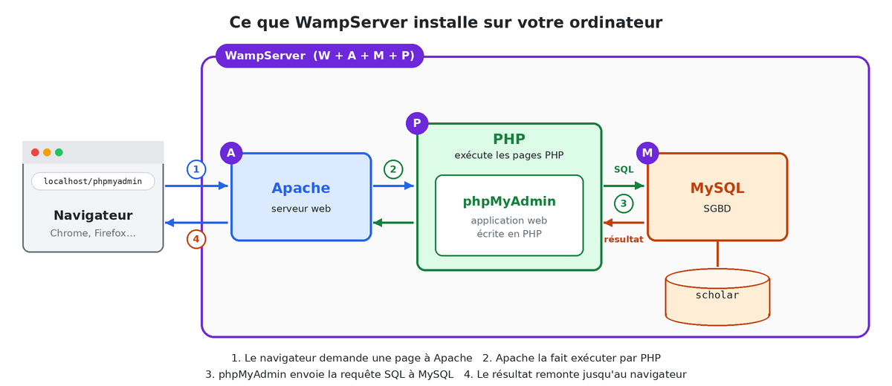
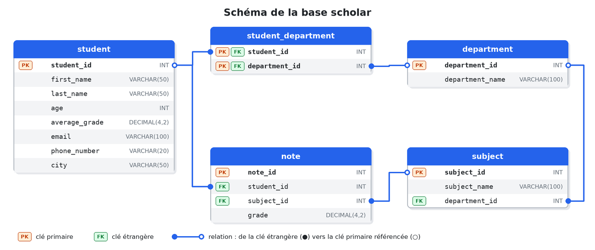

# Découvrir une base de données relationnelle

## Prise en main : installer MySQL et importer la base scholar

Assez de théorie : on installe les outils, on charge la base `scholar` et on lui pose ses premières questions.

---

### 1. Ce dont on a besoin

Pour travailler, il nous faut :

- un **SGBD** : **MySQL**, qui stocke les données et exécute les requêtes ;
- un **outil pour lui parler** : **phpMyAdmin**, une interface web qui permet de voir les bases, les tables, et d'écrire du SQL.

phpMyAdmin est une application écrite en PHP : elle a besoin d'un **serveur web** (Apache) et de **PHP** pour fonctionner. Plutôt que d'installer tout cela séparément, on utilise un **package** qui installe tout d'un coup : **WampServer**.

**WAMP** signifie **W**indows, **A**pache, **M**ySQL, **P**HP.

{ style="display: block; margin: 0 auto" }

Quand vous ouvrez phpMyAdmin dans votre navigateur, voici ce qui se passe :

1. le navigateur envoie une requête à **Apache**, le serveur web installé sur votre propre ordinateur (`localhost`) ;
2. Apache fait exécuter **phpMyAdmin** par **PHP** ;
3. phpMyAdmin envoie vos requêtes SQL à **MySQL** ;
4. MySQL lit ou modifie la base et renvoie le résultat, que phpMyAdmin affiche sous forme de tableau.

> **Vous êtes sur Mac ou Linux ?** WampServer n'existe que pour Windows. Les équivalents sont **MAMP** (Mac) et **XAMPP** (Windows, Mac et Linux). Ils installent la même chose : Apache, MySQL (ou MariaDB), PHP et phpMyAdmin. La suite du cours s'applique de la même façon.

---

### 2. Installer WampServer

1. Rendez-vous sur [wampserver.aviatechno.net](https://wampserver.aviatechno.net/) et téléchargez la dernière version **64 bits**.
2. Lancez l'installateur et laissez les options par défaut (dossier `C:\wamp64`).
3. Si l'installateur signale qu'il manque des **paquets Visual C++ Redistributable**, installez-les : ce sont des bibliothèques Microsoft dont Apache, PHP et MySQL ont besoin. WampServer indique où les trouver.
4. En fin d'installation, on vous demande de choisir un navigateur et un éditeur de texte par défaut : laissez ceux proposés ou choisissez les vôtres.

#### Démarrer WampServer

Lancez WampServer depuis le menu Démarrer. Une icône apparaît dans la barre des tâches, en bas à droite (parfois cachée derrière la petite flèche `^`). Sa **couleur** indique l'état des services :

| Couleur | Signification |
|---|---|
| 🟢 Vert | Tous les services sont démarrés : tout est prêt |
| 🟠 Orange | Une partie des services seulement est démarrée |
| 🔴 Rouge | Aucun service n'est démarré |

Si l'icône reste orange, la cause la plus fréquente est qu'un autre logiciel utilise déjà le **port 80** (celui d'Apache) : Skype, un autre serveur web, IIS… Fermez-le, puis faites un clic gauche sur l'icône et choisissez **Redémarrer les services**.

---

### 3. Découvrir phpMyAdmin

#### 3.1 Se connecter

Ouvrez votre navigateur à l'adresse : **http://localhost/phpmyadmin**

Sur l'écran de connexion :

- **Utilisateur** : `root`
- **Mot de passe** : laissez vide
- **Choix du serveur** : choisissez **MySQL**

> WampServer installe deux SGBD : **MySQL** et **MariaDB** (une version dérivée de MySQL, presque identique). Dans ce cours, nous utilisons **MySQL** : vérifiez bien ce choix à chaque connexion.

> `root` sans mot de passe, c'est le compte administrateur par défaut. C'est acceptable sur votre ordinateur pour apprendre, mais **jamais** sur un serveur en ligne.

#### 3.2 L'interface

L'écran de phpMyAdmin se divise en deux zones :

- **à gauche**, le **panneau de navigation** : la liste des bases de données. Un clic sur une base affiche ses tables, un clic sur une table affiche son contenu ;
- **à droite**, la **zone de travail**, avec des **onglets** en haut, qui changent selon l'endroit où vous êtes (serveur, base ou table).

Les onglets que nous utiliserons le plus :

| Onglet | Rôle |
|---|---|
| **SQL** | Écrire et exécuter vos propres requêtes : c'est l'onglet principal du cours |
| **Parcourir** | Afficher le contenu d'une table |
| **Structure** | Voir les colonnes d'une table, leurs types et leurs clés |
| **Importer** | Charger un fichier `.sql` (ou `.csv`) |
| **Exporter** | Sauvegarder une base ou une table dans un fichier |
| **Concepteur** (menu **Plus**) | Voir le schéma de la base, avec les tables et leurs relations |

Certaines bases sont déjà présentes à gauche : `information_schema`, `mysql`, `performance_schema`, `sys`. Ce sont les **bases système** de MySQL, qui contiennent son fonctionnement interne. **On n'y touche pas.**

---

### 4. Importer la base scholar

Le fichier `scholar.sql` qui vous est fourni est un **script SQL** : une suite d'instructions qui créent la base, ses tables, puis y insèrent les données.

Ouvrez-le dans votre éditeur de texte pour voir à quoi il ressemble :

```sql
-- Création de la base de données scholar
CREATE DATABASE IF NOT EXISTS scholar;

-- Sélection de la base de données à utiliser
USE scholar;

-- Création de la table `student`
CREATE TABLE student (
    student_id INT AUTO_INCREMENT PRIMARY KEY,
    first_name VARCHAR(50) NOT NULL,
    ...
```

Vous ne comprenez pas encore tout : c'est normal, nous écrirons ce genre de script nous-mêmes en partie 5. Pour l'instant, on le fait simplement exécuter par MySQL.

#### 4.1 Méthode 1 : l'onglet Importer

1. Cliquez sur le **logo phpMyAdmin** en haut à gauche, pour revenir au niveau du **serveur** (aucune base sélectionnée). Le script crée lui-même la base : il ne faut donc pas en sélectionner une.
2. Ouvrez l'onglet **Importer**.
3. Cliquez sur **Choisir un fichier** et sélectionnez `scholar.sql`.
4. Laissez les autres options par défaut et cliquez sur **Importer** (ou **Exécuter**, selon la version) en bas de la page.

Si tout s'est bien passé, un message vert indique que l'importation a réussi, et la base `scholar` apparaît dans le panneau de gauche (actualisez la page si besoin).

#### 4.2 Méthode 2 : l'onglet SQL

On peut aussi ouvrir `scholar.sql` dans un éditeur, **copier tout son contenu**, le **coller** dans l'onglet **SQL** de phpMyAdmin (toujours au niveau du serveur) et cliquer sur **Exécuter**. Le résultat est le même.

#### 4.3 En cas d'erreur

| Message | Cause | Solution |
|---|---|---|
| `#1050 - Table 'student' already exists` | La base a déjà été importée | Supprimez la base (voir ci-dessous), puis recommencez l'import |
| `#1273 - Unknown collation: 'utf8mb4_0900_ai_ci'` | Vous êtes connecté à **MariaDB** et non à MySQL | Déconnectez-vous et reconnectez-vous en choisissant **MySQL** |
| `#1046 - No database selected` | Une partie du script a été copiée sans la ligne `USE scholar;` | Copiez **tout** le fichier, du début à la fin |

#### 4.4 Sauvegarder une base

Avant de faire des essais risqués, il est prudent de **sauvegarder** la base. C'est le rôle de l'onglet **Exporter** :

1. Sélectionnez la base `scholar` dans le panneau de gauche.
2. Ouvrez l'onglet **Exporter**.
3. Laissez la méthode **Rapide** et le format **SQL**, puis cliquez sur **Exporter** (ou **Exécuter**).
4. phpMyAdmin télécharge un fichier `scholar.sql`.

Ce fichier est, lui aussi, un **script SQL** qui recrée les tables et leurs données. Il ne ressemble pourtant pas exactement au fichier `scholar.sql` qui vous a été fourni : phpMyAdmin écrit le script à sa façon. Par exemple :

- il commence par un **en-tête** en commentaires (versions de phpMyAdmin et de MySQL, date de l'export) et quelques réglages (`SET …`) ;
- il entoure les noms de tables et de colonnes de **backticks** (voir 6.5) ;
- il ne contient **pas** de `CREATE DATABASE` : pour le réimporter, il faut d'abord créer ou sélectionner une base ;
- il ajoute les **clés** et l'`AUTO_INCREMENT` à la fin du fichier, avec des instructions `ALTER TABLE`.

Les deux scripts sont écrits différemment, mais ils produisent la même base.

#### 4.5 Repartir de zéro

Pour **repartir de zéro** (utile si vous avez abîmé les données en faisant des exercices) : sélectionnez la base `scholar`, onglet **Opérations**, puis **Supprimer la base de données (DROP)**. Ou, dans l'onglet SQL :

```sql
DROP DATABASE scholar;
```

Puis réimportez `scholar.sql`. Attention : la suppression est **définitive**.

**Pratiquons !!**

Rdv au fichier `1-exercices.md`, niveau 1.

---

### 5. Explorer la base

Avant d'écrire des requêtes, prenons le temps de regarder ce que contient `scholar`.

#### 5.1 Les tables

Cliquez sur `scholar` dans le panneau de gauche : la liste de ses **5 tables** s'affiche, avec le nombre de lignes de chacune.

> Ce nombre de lignes est parfois une **estimation**, précédée du signe `~`. MySQL calcule rapidement une valeur approchée plutôt que de compter toutes les lignes. Le nombre exact apparaît dans l'onglet **Parcourir** de la table, sous la forme « total de … ».

| Table | Contenu |
|---|---|
| `student` | Les élèves |
| `department` | Les départements (spécialisations) |
| `subject` | Les matières, chacune rattachée à un département |
| `student_department` | Les inscriptions des élèves dans les départements |
| `note` | Les notes des élèves dans les matières |

#### 5.2 Le contenu d'une table

Cliquez sur la table `student`, onglet **Parcourir** : les élèves s'affichent sous forme de tableau. phpMyAdmin n'affiche que les **25 premières lignes** par défaut : utilisez les flèches de pagination pour voir la suite.

Repérez les cellules marquées `NULL` dans la colonne `email` : ce sont les élèves qui n'ont pas renseigné d'adresse.

#### 5.3 La structure d'une table

Toujours sur `student`, onglet **Structure** : chaque **colonne** de la table est décrite sur une ligne.

| Information | Exemple pour `student_id` | Signification |
|---|---|---|
| **Nom** | `student_id` | Le nom de la colonne |
| **Type** | `int` | Le type de données |
| **Null** | Non | `NULL` autorisé ou non |
| **Défaut** | Aucun(e) | Valeur utilisée si on n'en donne pas |
| **Extra** | `AUTO_INCREMENT` | Numérotation automatique |

Une **petite clé** dorée à côté du nom indique la **clé primaire**. Comparez avec les colonnes `email` (Null : Oui) et `first_name` (Null : Non).

Ouvrez ensuite la structure de la table `student_department` : la petite clé apparaît sur **deux colonnes**, `student_id` et `department_id`. C'est une **clé primaire composée** : ce n'est pas chaque colonne qui doit être unique, mais le **couple** des deux. Un même élève peut apparaître sur plusieurs lignes (s'il est inscrit dans plusieurs départements), un même département aussi, mais le même couple élève / département ne peut exister qu'une seule fois : on ne s'inscrit pas deux fois dans le même département. Ces deux colonnes sont en même temps des **clés étrangères**, vers `student` et vers `department`.

Ouvrez maintenant la structure de la table `subject` : la colonne `department_id` est une **clé étrangère**. Le lien **Vue relationnelle**, au-dessus ou en dessous de la liste des colonnes, montre vers quelle table et quelle colonne elle pointe.

#### 5.4 Le schéma de la base

Sélectionnez la base `scholar`, menu **Plus**, puis **Concepteur**. phpMyAdmin dessine toutes les tables et les **liens** entre clés étrangères et clés primaires. Vous retrouvez le schéma vu en partie 1.A :

{ style="display: block; margin: 0 auto" }

Vous pouvez déplacer les tables à la souris pour rendre le schéma plus lisible.

**Pratiquons !!**

Rdv au fichier `1-exercices.md`, niveau 2.

---

### 6. Vos premières requêtes

Place au SQL. Sélectionnez la base `scholar` dans le panneau de gauche, puis ouvrez l'onglet **SQL**. Le titre de la zone de saisie indique **Exécuter une ou des requêtes SQL sur la base de données scholar** : vos requêtes s'appliqueront à cette base.

#### 6.1 Afficher toute une table

```sql
SELECT *
FROM student;
```

Cliquez sur **Exécuter** (ou `Ctrl` + `Entrée`).

- `SELECT` : « je veux voir… »
- `*` : « … toutes les colonnes… »
- `FROM student` : « … de la table `student` ».

Au-dessus du résultat, phpMyAdmin affiche un message du type :

```
Affichage des lignes 0 - 24 (total de 39, traitement en 0,0004 seconde(s).)
```

La base contient donc **39 élèves**, et la requête a été traitée en une fraction de milliseconde.

#### 6.2 Choisir les colonnes

On peut ne demander que certaines colonnes, en les séparant par des virgules :

```sql
SELECT first_name, last_name, city
FROM student;
```

Les colonnes s'affichent dans l'ordre où on les a écrites.

#### 6.3 Deux commandes utiles

```sql
-- Lister les tables de la base
SHOW TABLES;

-- Décrire la structure d'une table (comme l'onglet Structure)
DESCRIBE student;
```

Ces deux commandes sont propres à MySQL, mais très pratiques pour se repérer sans quitter l'onglet SQL.

**Pratiquons !!**

Rdv au fichier `1-exercices.md`, niveau 3.

#### 6.4 Lire un message d'erreur

Vous ferez des erreurs : tout le monde en fait. L'important est de **lire le message**, qui indique presque toujours le problème. Par exemple :

```sql
SELECT firstname
FROM student;
```

```
#1054 - Unknown column 'firstname' in 'field list'
```

(Selon la configuration de MySQL, le message peut aussi s'afficher en français : `Champ 'firstname' inconnu dans field list`.)

MySQL ne trouve pas de colonne `firstname` : la bonne orthographe est `first_name`. En cas de doute, l'onglet **Structure** ou `DESCRIBE` donnent le nom exact des colonnes.

Les erreurs les plus courantes en débutant :

| Erreur | Exemple | Correct |
|---|---|---|
| Nom de colonne ou de table mal écrit | `SELECT firstname` | `SELECT first_name` |
| Virgule en trop avant `FROM` | `SELECT first_name, FROM student` | `SELECT first_name FROM student` |
| Virgule oubliée entre deux colonnes | `SELECT first_name last_name` | `SELECT first_name, last_name` |
| Mot-clé mal écrit | `SELECT * FORM student` | `SELECT * FROM student` |
| Mauvaise base sélectionnée | `#1146 - Table 'mysql.student' doesn't exist` | Sélectionner `scholar` à gauche |

Les virgules en trop et les mots-clés mal écrits provoquent une **erreur de syntaxe**, de code `#1064` :

```sql
SELECT first_name, last_name,
FROM student;
```

```
#1064 - You have an error in your SQL syntax; check the manual that corresponds
to your MySQL server version for the right syntax to use near 'FROM student' at line 2
```

Ce message est long, mais seule la fin compte : `near 'FROM student' at line 2`. MySQL indique l'endroit où il s'est arrêté, sans comprendre la suite. **L'erreur se trouve juste avant** ce passage : ici, la virgule à la fin de la ligne 1, qui annonce une colonne qui ne vient jamais.

Pour résumer les trois codes que vous rencontrerez le plus :

| Code | Signification | Où chercher |
|---|---|---|
| `#1064` | Erreur de syntaxe : la requête est mal écrite | Juste avant le passage cité après `near` |
| `#1054` | Colonne inconnue | Le nom de la colonne citée |
| `#1146` | Table inconnue | Le nom de la table, ou la base sélectionnée |

> **Attention au piège de la virgule oubliée** : `SELECT first_name last_name FROM student` ne provoque **pas** d'erreur ! MySQL comprend « affiche `first_name` et renomme la colonne en `last_name` ». Le résultat a l'air correct, mais il est faux. Nous reverrons ce renommage (les **alias**) en partie 2.

#### 6.5 Guillemets et backticks

Trois caractères se ressemblent mais ont des rôles bien différents en MySQL :

| Caractère | Nom | Rôle | Exemple |
|---|---|---|---|
| `'…'` | Apostrophes (guillemets simples) | Entourer une **valeur** texte | `'Alice'` |
| `` `…` `` | Backticks (accents graves) | Entourer un **nom** de table ou de colonne | `` `student` `` |
| `"…"` | Guillemets doubles | Acceptés par MySQL pour les valeurs, mais à éviter | |

Les backticks sont facultatifs dans la plupart des cas, et phpMyAdmin les ajoute automatiquement dans les requêtes qu'il génère. Mais **une valeur se met toujours entre apostrophes** : si vous écrivez `` `Alice` ``, MySQL cherchera une **colonne** nommée Alice.

**Pratiquons !!**

Rdv au fichier `1-exercices.md`, niveaux 4 et 5.

---

### 7. Les autres outils

phpMyAdmin n'est pas le seul moyen de travailler avec MySQL. Vous rencontrerez aussi :

- **MySQL Workbench** : l'outil officiel de MySQL, une application de bureau avec un éditeur SQL et un outil de modélisation ;
- **DBeaver** : un client gratuit qui se connecte à presque tous les SGBD (MySQL, PostgreSQL, SQLite…) ;
- **la console MySQL** : en ligne de commande, accessible depuis l'icône WampServer (**MySQL** > **Console MySQL**). On s'y connecte avec `root` et un mot de passe vide ;
- **les extensions de VS Code**, qui permettent d'écrire et d'exécuter du SQL sans quitter l'éditeur.

Tous envoient les mêmes requêtes SQL au même SGBD : ce que vous apprenez dans phpMyAdmin est valable partout.

---

### 8. En résumé

- **WampServer** installe Apache, MySQL, PHP et **phpMyAdmin**, accessible à l'adresse **http://localhost/phpmyadmin** (utilisateur `root`, sans mot de passe, serveur **MySQL**).
- On charge une base à partir d'un **script SQL** avec l'onglet **Importer** (ou en collant le script dans l'onglet **SQL**).
- Les onglets **Parcourir**, **Structure** et **Concepteur** permettent d'explorer une base avant de l'interroger.
- Une requête s'écrit dans l'onglet **SQL**, après avoir sélectionné la bonne base : `SELECT colonnes FROM table;`
- Un message d'erreur se **lit** : il indique presque toujours ce qui ne va pas.
- Les **valeurs** texte s'écrivent entre **apostrophes** `'…'`, les **noms** de tables et colonnes éventuellement entre **backticks** `` `…` ``.

---

*Sources :*
*- Julien POIRIER*
*- wampserver.com*
*- phpmyadmin.net*
*- sql.sh*

---

© Vincent Chiofalo