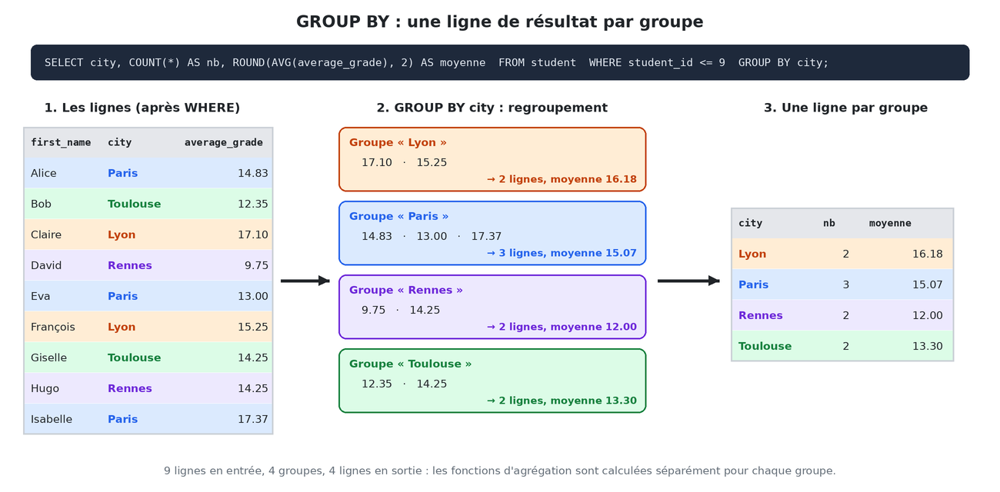

# Interroger les données

## Regrouper et agréger les données

Jusqu'ici, chaque ligne du résultat correspondait à une ligne de la table. Mais on a souvent besoin d'une **synthèse** : combien y a-t-il d'élèves ? Quelle est la moyenne générale ? Combien d'élèves par ville ? Quelle ville a la meilleure moyenne ? C'est le rôle des **fonctions d'agrégation** et de la clause **`GROUP BY`**.

---

### 1. Les fonctions d'agrégation

#### 1.1 Principe

Une fonction d'agrégation prend **toutes les valeurs d'une colonne** et les résume en **une seule valeur**.

| Fonction | Rôle |
|---|---|
| `COUNT()` | Compter des lignes ou des valeurs |
| `SUM()` | Additionner des valeurs |
| `AVG()` | Calculer la moyenne |
| `MIN()` | Trouver la plus petite valeur |
| `MAX()` | Trouver la plus grande valeur |

```sql
SELECT COUNT(*) AS nb_eleves,
       ROUND(AVG(average_grade), 2) AS moyenne_generale,
       MIN(average_grade) AS plus_basse,
       MAX(average_grade) AS plus_haute
FROM student;
```

| nb_eleves | moyenne_generale | plus_basse | plus_haute |
|---|---|---|---|
| 42 | 14.33 | 9.75 | 18.40 |

42 lignes en entrée, **une seule** en sortie. Pensez à donner un alias à chaque calcul : sans lui, la colonne s'appellerait `ROUND(AVG(average_grade), 2)`.

#### 1.2 COUNT : trois façons de compter

```sql
SELECT COUNT(*), COUNT(email), COUNT(DISTINCT city)
FROM student;
```

| COUNT(*) | COUNT(email) | COUNT(DISTINCT city) |
|---|---|---|
| 42 | 37 | 4 |

- `COUNT(*)` compte les **lignes**, quel que soit leur contenu.
- `COUNT(colonne)` compte les **valeurs non `NULL`** de cette colonne : les 5 élèves sans email ne sont pas comptés.
- `COUNT(DISTINCT colonne)` compte les **valeurs différentes** : 42 élèves, mais seulement 4 villes.

#### 1.3 Les agrégats ignorent les NULL

C'est vrai pour **toutes** les fonctions d'agrégation, sauf `COUNT(*)`. Ainsi, `AVG(average_grade)` calcule la moyenne des **38** élèves qui ont une moyenne, et non des 42 :

| Calcul | Résultat | Ce qui est calculé |
|---|---|---|
| `AVG(average_grade)` | 14.33 | La somme des moyennes, divisée par 38 |
| `SUM(average_grade) / COUNT(*)` | 12.97 | La même somme, divisée par 42 : les élèves sans note comptent comme s'ils avaient 0 |

En général, c'est bien le premier calcul qu'on veut. Mais il faut savoir lequel on fait.

#### 1.4 MIN et MAX ne sont pas que pour les nombres

```sql
SELECT MIN(birth_date) AS plus_ancienne, MAX(birth_date) AS plus_recente,
       MIN(last_name) AS premier_alpha, MAX(last_name) AS dernier_alpha
FROM student;
```

| plus_ancienne | plus_recente | premier_alpha | dernier_alpha |
|---|---|---|---|
| 1994-01-01 | 2007-08-19 | Benoit | Vidal |

Sur une date, `MIN` donne la plus ancienne (donc l'élève le plus **âgé**), et `MAX` la plus récente. Sur du texte, ils suivent l'ordre alphabétique.

#### 1.5 SUM

`SUM` additionne des valeurs. Dans `scholar`, peu de colonnes s'additionnent de façon utile : additionner des notes n'a pas vraiment de sens. Dans une base de commandes, en revanche, c'est la fonction reine : `SUM(prix * quantite)` donne un chiffre d'affaires.

Un usage pratique dans `scholar` : combiner `SUM` et `CASE` pour **compter** les lignes qui respectent une condition.

```sql
-- Nombre total de notes, et nombre de notes au-dessus de la moyenne
SELECT COUNT(*) AS nb_notes,
       SUM(CASE WHEN grade >= 10 THEN 1 ELSE 0 END) AS nb_au_dessus_de_10
FROM note;
```

| nb_notes | nb_au_dessus_de_10 |
|---|---|
| 104 | 102 |

Chaque note vaut 1 si elle respecte la condition, 0 sinon : la somme donne le nombre de notes qui la respectent.

#### 1.6 Agréger avec WHERE

Le `WHERE` filtre les lignes **avant** le calcul :

```sql
-- Nombre de notes et moyenne en Programmation (matière n°1)
SELECT COUNT(*) AS nb_notes, ROUND(AVG(grade), 2) AS moyenne
FROM note
WHERE subject_id = 1;
```

| nb_notes | moyenne |
|---|---|
| 16 | 14.36 |

#### 1.7 Le piège : mélanger agrégat et colonne simple

On veut le nom de l'élève qui a la meilleure moyenne. Première idée :

```sql
SELECT first_name, last_name, MAX(average_grade)
FROM student;
```

Cette requête **ne fonctionne pas**. `MAX` résume 42 lignes en une seule valeur, mais `first_name` et `last_name` ont 42 valeurs différentes : laquelle afficher ? Selon sa configuration, MySQL :

- refuse la requête :
```
#1140 - In aggregated query without GROUP BY, expression #1 of SELECT list contains
nonaggregated column 'scholar.student.first_name'; this is incompatible with sql_mode=only_full_group_by
```
- ou, pire, l'accepte et affiche **un nom quelconque** (souvent celui de la première ligne) à côté de la note maximale, **sans prévenir**.

La bonne solution, vue en 2.A, consiste à trier et à garder la première ligne :

```sql
SELECT first_name, last_name, average_grade
FROM student
ORDER BY average_grade DESC
LIMIT 1;
```

Une autre solution, avec une sous-requête, sera vue en partie 2.D.

**Pratiquons !!**

Rdv au fichier `2-exercices.md`, niveau 7.

---

### 2. Regrouper avec GROUP BY

#### 2.1 Principe

Jusqu'ici, les agrégats résumaient **toute la table** en une ligne. `GROUP BY` permet de les calculer **par groupe** : une ligne de résultat pour chaque valeur différente de la colonne indiquée.

```sql
-- Nombre d'élèves et moyenne, par ville
SELECT city, COUNT(*) AS nb_eleves, ROUND(AVG(average_grade), 2) AS moyenne
FROM student
GROUP BY city;
```

| city | nb_eleves | moyenne |
|---|---|---|
| Lyon | 11 | 14.89 |
| Paris | 11 | 14.69 |
| Rennes | 10 | 14.24 |
| Toulouse | 10 | 13.35 |

MySQL range les lignes dans des « paquets », un par ville, puis calcule `COUNT` et `AVG` **séparément pour chaque paquet** :

{ style="display: block; margin: 0 auto" }

On peut ensuite trier les groupes, y compris sur un agrégat :

```sql
-- Les villes, de la meilleure moyenne à la moins bonne
SELECT city, ROUND(AVG(average_grade), 2) AS moyenne
FROM student
GROUP BY city
ORDER BY moyenne DESC;
```

#### 2.2 La règle d'or du GROUP BY

> Dans une requête avec `GROUP BY`, chaque colonne du `SELECT` doit être **soit dans le `GROUP BY`**, **soit dans une fonction d'agrégation**.

C'est la même logique que le piège vu en 1.7 :

```sql
-- Incorrect : quel first_name afficher pour le groupe « Paris », qui contient 11 élèves ?
SELECT city, first_name, COUNT(*)
FROM student
GROUP BY city;
-- #1055 - Expression #2 of SELECT list is not in GROUP BY clause and contains
-- nonaggregated column 'scholar.student.first_name' […]
```

Une exception utile : si on regroupe par la **clé primaire** d'une table, MySQL accepte les autres colonnes de cette table, puisqu'il n'y a forcément qu'une valeur par groupe. `GROUP BY student_id` permet donc d'afficher aussi `first_name` et `last_name`. Ce sera pratique avec les jointures, en partie 2.D.

#### 2.3 Regrouper sur la table note

La table `note` se prête bien aux regroupements : chaque ligne est une note, et on veut souvent des statistiques par élève ou par matière.

```sql
-- Nombre de notes et moyenne, par matière
SELECT subject_id, COUNT(*) AS nb_notes, ROUND(AVG(grade), 2) AS moyenne
FROM note
GROUP BY subject_id;
```

| subject_id | nb_notes | moyenne |
|---|---|---|
| 1 | 16 | 14.36 |
| 2 | 16 | 13.82 |
| 3 | 14 | 15.34 |
| 4 | 14 | 14.42 |
| 5 | 13 | 14.47 |
| 6 | 12 | 14.58 |
| 7 | 9 | 15.22 |
| 8 | 10 | 14.87 |

On n'a ici que le **numéro** de la matière. Pour afficher son nom, qui se trouve dans la table `subject`, il faudra une **jointure** (partie 2.D).

#### 2.4 Regrouper sur un calcul

On peut regrouper sur le résultat d'une fonction :

```sql
-- Nombre de notes par année
SELECT YEAR(note_date) AS annee, COUNT(*) AS nb_notes
FROM note
GROUP BY YEAR(note_date);
```

| annee | nb_notes |
|---|---|
| 2024 | 8 |
| 2025 | 49 |
| 2026 | 47 |

#### 2.5 Regrouper sur plusieurs colonnes

Avec plusieurs colonnes, un groupe correspond à chaque **combinaison** de valeurs :

```sql
-- Nombre de notes de chaque élève dans chaque matière
SELECT student_id, subject_id, COUNT(*) AS nb_notes
FROM note
GROUP BY student_id, subject_id;
```

| student_id | subject_id | nb_notes |
|---|---|---|
| 1 | 1 | 2 |
| 1 | 2 | 1 |
| 2 | 3 | 1 |
| … | … | … |

Alice Dupont (élève n°1) a deux notes en Programmation (matière n°1) et une en Réseaux (matière n°2).

---

### 3. Filtrer les groupes avec HAVING

#### 3.1 Principe

On veut maintenant les villes dont la moyenne dépasse 14,5. Le réflexe serait d'écrire `WHERE AVG(average_grade) > 14.5`, mais c'est **impossible** : le `WHERE` filtre les lignes **avant** le regroupement, à un moment où la moyenne de chaque ville n'est pas encore calculée.

Pour filtrer **après** le regroupement, on utilise `HAVING` :

```sql
SELECT city, ROUND(AVG(average_grade), 2) AS moyenne
FROM student
GROUP BY city
HAVING AVG(average_grade) > 14.5;
```

| city | moyenne |
|---|---|
| Lyon | 14.89 |
| Paris | 14.69 |

```sql
-- Les élèves qui ont au moins 4 notes
SELECT student_id, COUNT(*) AS nb_notes
FROM note
GROUP BY student_id
HAVING COUNT(*) >= 4;
```

| student_id | nb_notes |
|---|---|
| 3 | 5 |
| 13 | 5 |
| 25 | 5 |
| 41 | 4 |

#### 3.2 WHERE ou HAVING ?

| | `WHERE` | `HAVING` |
|---|---|---|
| Filtre… | les **lignes** | les **groupes** |
| Moment | **Avant** le `GROUP BY` | **Après** le `GROUP BY` |
| Peut contenir un agrégat (`COUNT`, `AVG`…) | Non | Oui |

Les deux peuvent se combiner dans une même requête :

```sql
-- Parmi les élèves nés en 2003 ou après, les villes qui en comptent au moins 4
SELECT city, COUNT(*) AS nb_eleves
FROM student
WHERE birth_date >= '2003-01-01'
GROUP BY city
HAVING COUNT(*) >= 4;
```

| city | nb_eleves |
|---|---|
| Paris | 6 |
| Toulouse | 7 |

1. Le `WHERE` garde les 17 élèves nés en 2003 ou après.
2. Le `GROUP BY` les répartit par ville : Lyon 1, Paris 6, Rennes 3, Toulouse 7.
3. Le `HAVING` ne garde que les villes qui en ont au moins 4.

> **Règle pratique** : si la condition porte sur une colonne de la table, c'est un `WHERE`. Si elle porte sur un résultat de `COUNT`, `SUM`, `AVG`, `MIN` ou `MAX`, c'est un `HAVING`.

#### 3.3 Alias et HAVING

MySQL accepte d'utiliser un alias dans le `HAVING` (`HAVING nb_eleves >= 4`), mais ce n'est pas le cas de tous les SGBD. Répéter l'agrégat (`HAVING COUNT(*) >= 4`) fonctionne partout.

**Pratiquons !!**

Rdv au fichier `2-exercices.md`, niveau 8.

---

### 4. L'ordre complet d'une requête

Une requête `SELECT` peut maintenant contenir jusqu'à 7 clauses. Elles s'**écrivent** toujours dans cet ordre :

```sql
SELECT city, COUNT(*) AS nb_eleves
FROM student
WHERE birth_date >= '2003-01-01'
GROUP BY city
HAVING COUNT(*) >= 4
ORDER BY nb_eleves DESC
LIMIT 3;
```

Mais MySQL les **exécute** dans un autre ordre :

| Étape | Clause | Ce qui se passe |
|---|---|---|
| 1 | `FROM` | On prend la table |
| 2 | `WHERE` | On garde les lignes qui respectent la condition |
| 3 | `GROUP BY` | On range les lignes restantes en groupes |
| 4 | `HAVING` | On garde les groupes qui respectent la condition |
| 5 | `SELECT` | On calcule les colonnes à afficher et leurs alias |
| 6 | `ORDER BY` | On trie |
| 7 | `LIMIT` | On garde les premières lignes |

Cet ordre explique la plupart des règles vues jusqu'ici :

- un agrégat est impossible dans le `WHERE` : les groupes n'existent pas encore (étape 2 avant l'étape 3) ;
- un alias est impossible dans le `WHERE`, mais possible dans le `ORDER BY` (étape 5 avant l'étape 6) ;
- `LIMIT` s'applique en tout dernier, sur le résultat déjà trié.

---

### 5. En résumé

- Les **fonctions d'agrégation** (`COUNT`, `SUM`, `AVG`, `MIN`, `MAX`) résument plusieurs lignes en une seule valeur.
- `COUNT(*)` compte les lignes, `COUNT(colonne)` les valeurs non `NULL`, `COUNT(DISTINCT colonne)` les valeurs différentes.
- Les agrégats **ignorent les `NULL`** (sauf `COUNT(*)`).
- `GROUP BY` calcule les agrégats **par groupe** : une ligne de résultat par valeur (ou combinaison de valeurs).
- Avec `GROUP BY`, chaque colonne du `SELECT` est soit **dans le `GROUP BY`**, soit **dans un agrégat**.
- `WHERE` filtre les **lignes** avant le regroupement, `HAVING` filtre les **groupes** après.
- Ordre d'exécution : `FROM` → `WHERE` → `GROUP BY` → `HAVING` → `SELECT` → `ORDER BY` → `LIMIT`.

---

*Sources :*
*- Julien POIRIER*
*- sql.sh*
*- dev.mysql.com*

---

© Vincent Chiofalo
