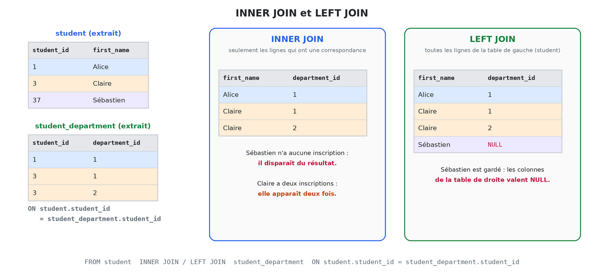

# Interroger les données

## Interroger plusieurs tables : jointures et sous-requêtes

Jusqu'ici, chaque requête ne portait que sur **une seule** table. Mais dans une base relationnelle, l'information est volontairement **répartie** entre plusieurs tables reliées par des clés (partie 1.A). La table `note`, par exemple, ne contient que des **numéros** :

| note_id | student_id | subject_id | grade | note_date |
|---|---|---|---|---|
| 1 | 1 | 1 | 15.00 | 2025-12-15 |
| 2 | 1 | 2 | 14.00 | 2026-01-17 |
| 3 | 1 | 1 | 15.50 | 2026-03-11 |

Pour afficher « Alice Dupont a eu 15 en Programmation », il faut aller chercher le nom de l'élève dans `student` et le nom de la matière dans `subject`. C'est le rôle des **jointures**. Nous verrons ensuite une autre façon de combiner des requêtes : les **sous-requêtes**.

---

### 1. Le principe de la jointure

#### 1.1 INNER JOIN

Une jointure **assemble** les lignes de deux tables qui se correspondent. La correspondance est indiquée après `ON` : le plus souvent, la **clé étrangère** d'une table est égale à la **clé primaire** de l'autre.

```sql
-- Chaque note, avec le nom de l'élève
SELECT student.first_name, student.last_name, note.grade, note.note_date
FROM note
INNER JOIN student ON note.student_id = student.student_id;
```

| first_name | last_name | grade | note_date |
|---|---|---|---|
| Alice | Dupont | 15.00 | 2025-12-15 |
| Alice | Dupont | 14.00 | 2026-01-17 |
| Alice | Dupont | 15.50 | 2026-03-11 |
| Bob | Martin | 13.20 | 2025-11-11 |
| … | … | … | … |

Pour chaque ligne de `note`, MySQL cherche **la** ligne de `student` dont le `student_id` est le même, et colle les deux. On obtient 104 lignes : une par note.

`INNER JOIN` peut s'écrire simplement `JOIN` : les deux sont identiques.

#### 1.2 Préfixer les colonnes

Quand plusieurs tables sont en jeu, une même colonne peut exister dans plusieurs d'entre elles : `student_id` est à la fois dans `note` et dans `student`. On **préfixe** donc les colonnes par le nom de leur table : `note.student_id`, `student.student_id`.

Sans préfixe, MySQL refuse une colonne qui existe dans les deux tables :

```
#1052 - Column 'student_id' in field list is ambiguous
```

Pour les colonnes qui n'existent que dans une table (`first_name`, `grade`), le préfixe n'est pas obligatoire, mais il rend la requête beaucoup plus lisible : on sait d'où vient chaque colonne.

#### 1.3 Les alias de tables

Préfixer chaque colonne par un nom de table complet devient vite lourd. Comme pour les colonnes (partie 2.A), on peut donner un **alias** à une table, souvent sa première lettre :

```sql
SELECT s.first_name, s.last_name, n.grade, n.note_date
FROM note AS n
INNER JOIN student AS s ON n.student_id = s.student_id;
```

Le `AS` est facultatif pour les tables, et on l'omet souvent : `FROM note n`. Une fois l'alias défini, il faut l'utiliser **partout** dans la requête.

Dans la suite, nous utiliserons ces alias : `s` pour `student`, `n` pour `note`, `su` pour `subject`, `d` pour `department`, `sd` pour `student_department`.

#### 1.4 Joindre plus de deux tables

On peut enchaîner autant de jointures que nécessaire, chacune avec sa condition :

```sql
-- Les notes d'Alice Dupont, avec le nom de la matière
SELECT s.first_name, s.last_name, su.subject_name, n.grade
FROM note n
INNER JOIN student s ON n.student_id = s.student_id
INNER JOIN subject su ON n.subject_id = su.subject_id
WHERE s.student_id = 1;
```

| first_name | last_name | subject_name | grade |
|---|---|---|---|
| Alice | Dupont | Programmation | 15.00 |
| Alice | Dupont | Réseaux | 14.00 |
| Alice | Dupont | Programmation | 15.50 |

Pour trouver les jointures à écrire, on suit les **liens du schéma** (image `schema-scholar.png` de la partie 1.A) : de la table de départ, on passe de clé étrangère en clé primaire jusqu'à atteindre les tables dont on a besoin.

#### 1.5 Passer par une table d'association

Les départements d'un élève ne sont pas dans `student`, ni dans `department` : le lien est fait par la table d'association `student_department`. Pour aller de l'élève au nom de son département, il faut donc **deux** jointures :

```sql
-- Les départements de chaque élève
SELECT s.first_name, s.last_name, d.department_name, sd.enrollment_date
FROM student s
INNER JOIN student_department sd ON s.student_id = sd.student_id
INNER JOIN department d ON sd.department_id = d.department_id;
```

| first_name | last_name | department_name | enrollment_date |
|---|---|---|---|
| Alice | Dupont | Informatique | 2025-09-01 |
| Claire | Lemoine | Mathématiques | 2023-09-04 |
| Claire | Lemoine | Informatique | 2026-01-12 |
| … | … | … | … |

Claire Lemoine apparaît **deux fois**, car elle est inscrite dans deux départements : une jointure renvoie une ligne **par correspondance**, pas une ligne par élève. Le résultat compte 41 lignes, une par inscription.

---

### 2. INNER JOIN et LEFT JOIN

#### 2.1 Ce que fait INNER JOIN… et ce qu'il oublie

La requête précédente renvoie 41 lignes pour 42 élèves : certains apparaissent deux fois, d'autres **pas du tout**. Sébastien Vidal, par exemple, n'est inscrit dans aucun département. Comme `INNER JOIN` ne garde que les lignes qui ont une **correspondance** dans les deux tables, il a tout simplement **disparu** du résultat.

C'est parfois ce qu'on veut (« les élèves **et** leurs départements »), parfois non (« **tous** les élèves, avec leur département s'ils en ont un »). Pour ce deuxième cas, on utilise `LEFT JOIN`.

{ style="display: block; margin: 0 auto" }

#### 2.2 LEFT JOIN

`LEFT JOIN` garde **toutes les lignes de la table de gauche** (celle du `FROM`), même celles qui n'ont pas de correspondance. Dans ce cas, les colonnes de la table de droite valent `NULL`.

```sql
-- Tous les élèves, avec leurs départements s'ils en ont
SELECT s.first_name, s.last_name, d.department_name
FROM student s
LEFT JOIN student_department sd ON s.student_id = sd.student_id
LEFT JOIN department d ON sd.department_id = d.department_id;
```

| first_name | last_name | department_name |
|---|---|---|
| … | … | … |
| Sébastien | Vidal | *NULL* |
| Théodore | Chavanne | *NULL* |
| Yasmine | Lemoine | *NULL* |
| … | … | … |

Résultat : 45 lignes, les 41 inscriptions et les 4 élèves sans département.

> **Gauche ou droite ?** La table « de gauche », c'est celle qui est écrite **avant** le `JOIN`, c'est-à-dire dans le `FROM`. L'ordre des tables compte donc avec `LEFT JOIN`, alors qu'il ne change rien au résultat d'un `INNER JOIN`.

> Quand une requête contient plusieurs jointures, un `INNER JOIN` placé après un `LEFT JOIN` peut **supprimer** les lignes que le `LEFT JOIN` avait gardées. Ici, il faut un `LEFT JOIN` aux deux étapes pour garder Sébastien jusqu'au bout.

#### 2.3 Trouver les lignes sans correspondance

Un usage très courant du `LEFT JOIN` : trouver ce qui **n'a pas** de correspondance. On garde toutes les lignes de gauche, puis on ne retient que celles où la table de droite est `NULL` :

```sql
-- Les élèves inscrits dans aucun département
SELECT s.first_name, s.last_name
FROM student s
LEFT JOIN student_department sd ON s.student_id = sd.student_id
WHERE sd.student_id IS NULL;
```

| first_name | last_name |
|---|---|
| Sébastien | Vidal |
| Théodore | Chavanne |
| Yasmine | Lemoine |
| Lucas | Moreira |

De la même façon, du côté des départements :

```sql
-- Chaque département, avec ses matières
SELECT d.department_name, su.subject_name
FROM department d
LEFT JOIN subject su ON d.department_id = su.department_id;
```

| department_name | subject_name |
|---|---|
| Informatique | Programmation |
| Informatique | Réseaux |
| … | … |
| Chimie | Chimie Physique |
| Physique | *NULL* |

Le département Physique, qui n'a encore aucune matière, n'apparaît que grâce au `LEFT JOIN`.

#### 2.4 RIGHT JOIN

`RIGHT JOIN` fait exactement l'inverse : il garde toutes les lignes de la table **de droite**. Ces deux requêtes donnent le même résultat :

```sql
SELECT d.department_name, su.subject_name
FROM department d
LEFT JOIN subject su ON d.department_id = su.department_id;

SELECT d.department_name, su.subject_name
FROM subject su
RIGHT JOIN department d ON d.department_id = su.department_id;
```

Dans la pratique, on utilise presque toujours `LEFT JOIN`, en plaçant dans le `FROM` la table dont on veut garder toutes les lignes : les requêtes se lisent plus facilement dans le même sens.

#### 2.5 FULL OUTER JOIN

D'autres SGBD proposent `FULL OUTER JOIN`, qui garde les lignes sans correspondance **des deux côtés**. MySQL ne le propose pas : on obtient le même résultat en combinant un `LEFT JOIN` et un `RIGHT JOIN` avec `UNION`. Le cas est rare, et nous ne le détaillerons pas.

#### 2.6 CROSS JOIN

`CROSS JOIN` associe **chaque ligne** de la première table à **chaque ligne** de la seconde, sans condition. Avec deux tables :

**Table `prenoms`**

| prenom |
|---|
| Marie |
| Pierre |

**Table `couleurs`**

| couleur |
|---|
| Violet |
| Orange |

```sql
SELECT p.prenom, c.couleur
FROM prenoms p
CROSS JOIN couleurs c;
```

| prenom | couleur |
|---|---|
| Marie | Violet |
| Marie | Orange |
| Pierre | Violet |
| Pierre | Orange |

On obtient **toutes les combinaisons** possibles : si la première table a *n* lignes et la seconde *m*, le résultat en a *n × m*. On appelle cela le **produit cartésien**. Dans `scholar`, `student CROSS JOIN subject` donnerait 42 × 8 = 336 lignes, une par couple élève / matière.

L'usage est rare (générer un planning, toutes les combinaisons taille / couleur d'un produit…), mais il faut connaître le principe : c'est ce qu'on obtient **par erreur** quand on oublie la condition d'une jointure.

**Pratiquons !!**

Rdv au fichier `2-exercices.md`, niveau 9.

---

### 3. Jointures et regroupements

Les jointures se combinent avec tout ce qui a été vu jusqu'ici : `WHERE`, `ORDER BY`, fonctions, et surtout `GROUP BY`. On peut enfin afficher des statistiques avec des **noms** plutôt que des numéros.

```sql
-- Nombre de notes et moyenne par matière, de la meilleure à la moins bonne
SELECT su.subject_name, COUNT(*) AS nb_notes, ROUND(AVG(n.grade), 2) AS moyenne
FROM note n
INNER JOIN subject su ON n.subject_id = su.subject_id
GROUP BY su.subject_id, su.subject_name
ORDER BY moyenne DESC;
```

| subject_name | nb_notes | moyenne |
|---|---|---|
| Algèbre | 14 | 15.34 |
| Chimie Organique | 9 | 15.22 |
| Chimie Physique | 10 | 14.87 |
| Génétique | 12 | 14.58 |
| Biologie Cellulaire | 13 | 14.47 |
| Calcul différentiel | 14 | 14.42 |
| Programmation | 16 | 14.36 |
| Réseaux | 16 | 13.82 |

On regroupe par `su.subject_id` (deux matières pourraient avoir le même nom) **et** par `su.subject_name` (pour pouvoir l'afficher, d'après la règle d'or de la partie 2.C).

#### 3.1 Compter avec un LEFT JOIN

```sql
-- Nombre d'élèves inscrits dans chaque département
SELECT d.department_name, COUNT(sd.student_id) AS nb_eleves
FROM department d
LEFT JOIN student_department sd ON d.department_id = sd.department_id
GROUP BY d.department_id, d.department_name;
```

| department_name | nb_eleves |
|---|---|
| Informatique | 12 |
| Mathématiques | 11 |
| Biologie | 10 |
| Chimie | 8 |
| Physique | 0 |

> **Attention à `COUNT(*)`** : avec un `COUNT(*)`, Physique afficherait **1**, et non 0. Le `LEFT JOIN` produit en effet une ligne pour Physique (avec `NULL` dans les colonnes de `student_department`), et `COUNT(*)` compte les lignes. `COUNT(sd.student_id)` ne compte que les valeurs non `NULL`, et donne bien 0. Avec un `LEFT JOIN`, on compte toujours une colonne de la table de droite.

---

### 4. Les sous-requêtes

Une **sous-requête** est une requête écrite **à l'intérieur** d'une autre, entre parenthèses. MySQL exécute d'abord la sous-requête, puis utilise son résultat dans la requête principale.

#### 4.1 Une sous-requête qui renvoie une seule valeur

```sql
-- Les élèves dont la moyenne est supérieure à la moyenne générale
SELECT first_name, last_name, average_grade
FROM student
WHERE average_grade > (SELECT AVG(average_grade) FROM student);
```

1. La sous-requête calcule la moyenne générale : 14.33.
2. La requête principale devient `WHERE average_grade > 14.33`, et renvoie 18 élèves.

On ne pouvait pas écrire directement `WHERE average_grade > AVG(average_grade)` : un agrégat est interdit dans le `WHERE` (partie 2.C). La sous-requête contourne ce problème.

C'est aussi la solution propre au problème du « meilleur élève » de la partie 2.C :

```sql
SELECT first_name, last_name, average_grade
FROM student
WHERE average_grade = (SELECT MAX(average_grade) FROM student);
```

Résultat : Noah Brunet, 18.40. Contrairement à `ORDER BY … LIMIT 1`, cette requête renvoie **tous** les élèves ex aequo s'il y en a plusieurs.

#### 4.2 Une sous-requête qui renvoie une liste : IN et NOT IN

Quand la sous-requête renvoie **plusieurs** valeurs, on l'utilise avec `IN` (partie 2.B) :

```sql
-- Les élèves qui ont au moins une note en Programmation (matière n°1)
SELECT first_name, last_name
FROM student
WHERE student_id IN (SELECT student_id FROM note WHERE subject_id = 1);
```

La sous-requête renvoie la liste des numéros des élèves qui ont une note en Programmation, et la requête principale garde les élèves dont le numéro est dans cette liste. Résultat : 12 élèves, chacun **une seule fois**, même ceux qui ont deux notes dans la matière. Avec une jointure, ils apparaîtraient autant de fois qu'ils ont de notes.

```sql
-- Les élèves qui n'ont aucune note
SELECT first_name, last_name
FROM student
WHERE student_id NOT IN (SELECT student_id FROM note);
```

Résultat : Sébastien Vidal, Théodore Chavanne, Yasmine Lemoine et Lucas Moreira. C'est le même résultat qu'avec un `LEFT JOIN … WHERE … IS NULL` (paragraphe 2.3) : les deux façons de faire sont correctes.

> **Attention à `NOT IN` et `NULL`** : si la liste renvoyée par la sous-requête contient un seul `NULL`, `NOT IN` ne renvoie **plus aucune ligne**. Ici, `note.student_id` n'est jamais vide, donc il n'y a pas de problème. Dans le doute, ajoutez `WHERE colonne IS NOT NULL` dans la sous-requête, ou utilisez la version `LEFT JOIN`.

#### 4.3 Une sous-requête dans le FROM

Une sous-requête peut aussi servir de **table temporaire** dans le `FROM`. Elle doit alors obligatoirement avoir un **alias** :

```sql
-- Combien de notes un élève a-t-il en moyenne ?
SELECT ROUND(AVG(nb_notes), 2) AS moyenne_notes_par_eleve,
       MIN(nb_notes) AS minimum,
       MAX(nb_notes) AS maximum
FROM (
    SELECT student_id, COUNT(*) AS nb_notes
    FROM note
    GROUP BY student_id
) AS notes_par_eleve;
```

| moyenne_notes_par_eleve | minimum | maximum |
|---|---|---|
| 2.74 | 2 | 5 |

1. La sous-requête calcule le nombre de notes de chaque élève (une ligne par élève qui a au moins une note).
2. La requête principale calcule la moyenne, le minimum et le maximum de ces nombres.

C'est un moyen de faire un **agrégat d'agrégat**, impossible en une seule requête (`AVG(COUNT(*))` provoque une erreur).

#### 4.4 Jointure ou sous-requête ?

Beaucoup de questions peuvent se résoudre des deux façons. Quelques repères :

- pour **afficher** des colonnes de plusieurs tables, il faut une **jointure** ;
- pour **filtrer** selon le contenu d'une autre table (« les élèves qui ont une note en… »), une sous-requête avec `IN` est souvent plus lisible, et évite les doublons ;
- pour comparer à une valeur **calculée** (moyenne, maximum), la sous-requête est la solution naturelle ;
- en cas de doute, choisissez la version que **vous** relisez le plus facilement.

**Pratiquons !!**

Rdv au fichier `2-exercices.md`, niveau 10.

---

### 5. Méthode pour écrire une requête sur plusieurs tables

1. **Lister les colonnes** demandées, et repérer dans quelle table se trouve chacune.
2. **Trouver le chemin** entre ces tables sur le schéma de la base, en passant si besoin par des tables intermédiaires (comme `student_department`).
3. **Choisir le type de jointure** : faut-il garder les lignes sans correspondance (`LEFT JOIN`) ou non (`INNER JOIN`) ?
4. **Écrire le `FROM` et les jointures**, une par ligne, et exécuter un premier `SELECT *` pour vérifier le résultat.
5. **Ajouter** ensuite `WHERE`, `GROUP BY`, `HAVING`, `ORDER BY`, en exécutant à chaque étape.
6. **Vérifier le nombre de lignes** : si le résultat contient des centaines de lignes inattendues, une condition de jointure est sans doute fausse ou oubliée.

---

### 6. En résumé

| Besoin | Syntaxe |
|---|---|
| Assembler deux tables (lignes avec correspondance) | `FROM a INNER JOIN b ON a.x = b.y` |
| Garder toutes les lignes de la table de gauche | `FROM a LEFT JOIN b ON a.x = b.y` |
| Garder toutes les lignes de la table de droite | `FROM a RIGHT JOIN b ON a.x = b.y` |
| Toutes les combinaisons possibles | `FROM a CROSS JOIN b` |
| Trouver les lignes sans correspondance | `LEFT JOIN … WHERE b.y IS NULL` |
| Comparer à une valeur calculée | `WHERE col > (SELECT AVG(col) FROM …)` |
| Filtrer selon une autre table | `WHERE col IN (SELECT … FROM …)` |
| Agréger un résultat déjà agrégé | `FROM (SELECT … GROUP BY …) AS alias` |

- La condition de jointure relie généralement une **clé étrangère** à la **clé primaire** qu'elle référence.
- On **préfixe** les colonnes par leur table, ou par un **alias** de table.
- Une jointure renvoie **une ligne par correspondance** : un élève inscrit dans deux départements apparaît deux fois.
- Avec un `LEFT JOIN`, on compte une colonne de la table de droite (`COUNT(b.y)`), jamais `COUNT(*)`.
- Une sous-requête dans le `FROM` doit avoir un **alias**.

---

*Sources :*
*- Julien POIRIER*
*- sql.sh*
*- dev.mysql.com*s

---

© Vincent Chiofalo