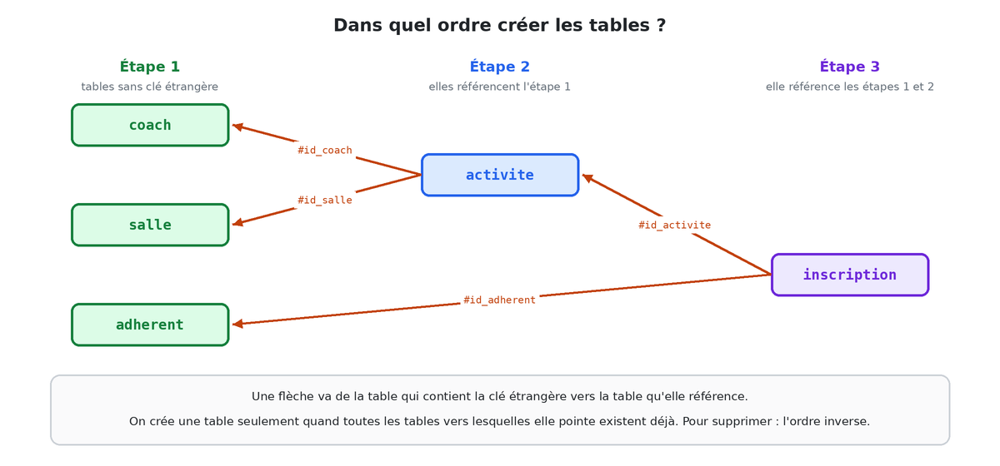

# Créer et gérer les tables

## Conception et création de tables dans une base de données

En partie 4, nous avons conçu des bases sur papier : un MCD, puis un MLD. Il reste la dernière étape de la méthode Merise : le **MPD** (Modèle Physique de Données), c'est-à-dire le **script SQL** qui crée réellement la base dans MySQL.

Jusqu'ici, la base `scholar` était fournie toute faite. Dans cette partie, c'est vous qui écrivez le script. Nous prendrons comme exemple le **club de sport** de la partie 4, dont voici le MLD :

```
coach (id_coach, nom, prenom, specialite)
salle (id_salle, nom, capacite)
adherent (id_adherent, nom, prenom, date_naissance, email)
activite (id_activite, nom, tarif, #id_coach, #id_salle)
inscription (#id_adherent, #id_activite, date_inscription)
```

Les instructions de cette partie appartiennent au **LDD** (Langage de Définition de Données, partie 1.A) : elles agissent sur la **structure** de la base, et non sur son contenu.

| Instruction | Rôle |
|---|---|
| `CREATE` | Créer une base, une table |
| `ALTER` | Modifier la structure d'une table |
| `DROP` | Supprimer une base, une table |

---

### 1. Du MLD au MPD

Passer du MLD au MPD, c'est ajouter tout ce qui dépend du **SGBD** choisi :

- le **type** exact de chaque colonne (`INT`, `VARCHAR(50)`, `DATE`…) ;
- les **contraintes** : colonne obligatoire, valeur unique, valeur par défaut… ;
- les **options propres à MySQL** : `AUTO_INCREMENT`, moteur de stockage, jeu de caractères.

Dans cette partie 5.A, nous utilisons quelques types simples. Ils sont détaillés en partie 5.B, avec toutes les contraintes.

| Type | Contenu | Exemple |
|---|---|---|
| `INT` | Nombre entier | `capacite INT` |
| `DECIMAL(6,2)` | Nombre décimal exact : 6 chiffres au total, dont 2 après la virgule | `tarif DECIMAL(6,2)` (jusqu'à 9999.99) |
| `VARCHAR(n)` | Texte de `n` caractères maximum | `nom VARCHAR(50)` |
| `DATE` | Date, au format `AAAA-MM-JJ` | `date_naissance DATE` |

---

### 2. Créer une base de données

#### 2.1 CREATE DATABASE

```sql
CREATE DATABASE club_sport
CHARACTER SET utf8mb4
COLLATE utf8mb4_0900_ai_ci;
```

- **`CHARACTER SET utf8mb4`** : le jeu de caractères. `utf8mb4` permet de stocker **tous** les caractères : accents, alphabets non latins, et même les émojis. C'est le bon choix par défaut.
- **`COLLATE utf8mb4_0900_ai_ci`** : la **collation**, c'est-à-dire la façon de comparer et de trier le texte. C'est elle qui rend les comparaisons insensibles aux accents (`ai`) et à la casse (`ci`), comme on l'a vu en partie 2.A.

Ces deux options sont celles de MySQL 8 par défaut : `CREATE DATABASE club_sport;` donne le même résultat. Les écrire rend le script explicite, et indépendant de la configuration du serveur.

Si la base existe déjà, MySQL refuse :

```
#1007 - Can't create database 'club_sport'; database exists
```

Pour éviter l'erreur, on peut écrire `CREATE DATABASE IF NOT EXISTS club_sport;` : la base n'est créée que si elle n'existe pas encore.

#### 2.2 Sélectionner la base : USE

```sql
USE club_sport;
```

Toutes les instructions suivantes s'appliqueront à cette base. Dans phpMyAdmin, cela revient à cliquer sur la base dans le panneau de gauche avant d'ouvrir l'onglet **SQL**.

#### 2.3 Les règles de nommage

MySQL accepte presque tous les noms, mais quelques règles évitent bien des ennuis :

- uniquement des **minuscules**, des **chiffres** et le **tiret bas** `_` : `date_naissance`, pas `Date de naissance` ;
- **pas d'accents, pas d'espaces** : sinon il faut entourer le nom de backticks à chaque utilisation ;
- **pas de mots réservés** du SQL (`order`, `group`, `select`, `date`…) : une table de commandes s'appellera `commande` ou `orders`, pas `order` ;
- **une seule langue** pour toute la base : tout en français (comme le club de sport) ou tout en anglais (comme `scholar`), mais pas un mélange ;
- **une convention pour les clés**, appliquée partout : ici `id_` suivi du nom de la table, et la clé étrangère porte le **même nom** que la clé primaire qu'elle référence.

---

### 3. Créer une table

#### 3.1 La syntaxe de CREATE TABLE

```sql
CREATE TABLE nom_table (
    colonne1 TYPE options,
    colonne2 TYPE options,
    …
    contraintes
);
```

Chaque colonne est décrite par son **nom**, son **type**, puis d'éventuelles **options**. Les lignes sont séparées par des **virgules**, sauf la dernière.

Première table du club, la plus simple :

```sql
CREATE TABLE coach (
    id_coach INT AUTO_INCREMENT PRIMARY KEY,
    nom VARCHAR(50) NOT NULL,
    prenom VARCHAR(50) NOT NULL,
    specialite VARCHAR(50)
);
```

Ligne par ligne :

| Ligne | Signification |
|---|---|
| `id_coach INT AUTO_INCREMENT PRIMARY KEY` | Un entier, numéroté automatiquement (1, 2, 3…), qui est la clé primaire |
| `nom VARCHAR(50) NOT NULL` | Un texte de 50 caractères maximum, **obligatoire** |
| `prenom VARCHAR(50) NOT NULL` | Idem |
| `specialite VARCHAR(50)` | Un texte de 50 caractères maximum, **facultatif** (sans `NOT NULL`, la colonne accepte `NULL`) |

On retrouve exactement la syntaxe du fichier `scholar.sql`, que vous avez ouvert en partie 1.B.

> **`AUTO_INCREMENT`** ne s'utilise que sur une colonne entière, qui est la clé primaire (ou une colonne unique). Une table ne peut en avoir qu'une seule.

#### 3.2 Les tables sans clé étrangère

On crée de la même façon les deux autres tables qui ne dépendent d'aucune autre :

```sql
CREATE TABLE salle (
    id_salle INT AUTO_INCREMENT PRIMARY KEY,
    nom VARCHAR(50) NOT NULL,
    capacite INT NOT NULL
);

CREATE TABLE adherent (
    id_adherent INT AUTO_INCREMENT PRIMARY KEY,
    nom VARCHAR(50) NOT NULL,
    prenom VARCHAR(50) NOT NULL,
    date_naissance DATE NOT NULL,
    email VARCHAR(100)
);
```

#### 3.3 Déclarer une clé étrangère

La table `activite` contient deux clés étrangères. Elles se déclarent en deux temps :

1. on crée la **colonne**, du **même type** que la clé primaire qu'elle référence (`INT`) ;
2. on la déclare comme clé étrangère avec `FOREIGN KEY … REFERENCES …`.

```sql
CREATE TABLE activite (
    id_activite INT AUTO_INCREMENT PRIMARY KEY,
    nom VARCHAR(50) NOT NULL,
    tarif DECIMAL(6,2) NOT NULL,
    id_coach INT NOT NULL,
    id_salle INT NOT NULL,
    FOREIGN KEY (id_coach) REFERENCES coach(id_coach),
    FOREIGN KEY (id_salle) REFERENCES salle(id_salle)
);
```

`FOREIGN KEY (id_coach) REFERENCES coach(id_coach)` se lit : « la colonne `id_coach` de cette table fait référence à la colonne `id_coach` de la table `coach` ».

Les deux clés étrangères sont `NOT NULL` : d'après le MCD, une activité a **toujours** un coach et une salle (cardinalité 1,1, partie 4.B).

> Comme on l'a vu en partie 4.B, une colonne qui **s'appelle** `id_coach` n'est pas pour autant une clé étrangère : c'est la ligne `FOREIGN KEY` qui crée le lien. Sans elle, MySQL accepterait n'importe quel numéro de coach, même inexistant.

On peut **nommer** une clé étrangère avec `CONSTRAINT`. C'est facultatif, mais les messages d'erreur deviennent plus lisibles, et la contrainte plus facile à supprimer ou à modifier ensuite :

```sql
CONSTRAINT fk_activite_coach FOREIGN KEY (id_coach) REFERENCES coach(id_coach)
```

Sans nom, MySQL en choisit un lui-même : `activite_ibfk_1`, `activite_ibfk_2`… C'est ce nom qu'on voit dans les messages d'erreur `#1452` (partie 3).

Les options `ON DELETE` et `ON UPDATE`, que vous avez rencontrées dans `scholar.sql` (`ON DELETE CASCADE`), seront étudiées en partie 7. Sans elles, MySQL **refuse** de supprimer un coach qui anime encore une activité.

#### 3.4 Une clé primaire composée

Pour la table d'association `inscription`, la clé primaire porte sur **deux colonnes**. On ne peut pas écrire `PRIMARY KEY` à la suite de chacune (ce serait deux clés primaires) : on la déclare **à la fin**, comme une contrainte.

```sql
CREATE TABLE inscription (
    id_adherent INT,
    id_activite INT,
    date_inscription DATE NOT NULL,
    PRIMARY KEY (id_adherent, id_activite),
    FOREIGN KEY (id_adherent) REFERENCES adherent(id_adherent),
    FOREIGN KEY (id_activite) REFERENCES activite(id_activite)
);
```

Les colonnes d'une clé primaire sont automatiquement `NOT NULL` : inutile de le préciser.

#### 3.5 L'ordre de création des tables

Une clé étrangère ne peut référencer qu'une table qui **existe déjà**. Si on crée `activite` avant `coach`, MySQL refuse :

```
#1824 - Failed to open the referenced table 'coach'
```

Il faut donc créer les tables **dans l'ordre des dépendances** : d'abord celles qui n'ont aucune clé étrangère, puis celles qui ne référencent que des tables déjà créées, et ainsi de suite.

{ style="display: block; margin: 0 auto" }

#### 3.6 Les erreurs fréquentes

| Code | Message (début) | Cause |
|---|---|---|
| `#1050` | Table '…' already exists | La table existe déjà |
| `#1064` | You have an error in your SQL syntax | Virgule oubliée entre deux colonnes, ou en trop après la dernière, parenthèse manquante… |
| `#1824` | Failed to open the referenced table | La table référencée n'existe pas encore (ordre de création) |
| `#3780` | Referencing column '…' and referenced column '…' are incompatible | La clé étrangère n'a pas le même type que la clé primaire référencée |
| `#1075` | Incorrect table definition; there can be only one auto column | Deux colonnes `AUTO_INCREMENT`, ou `AUTO_INCREMENT` sur une colonne qui n'est pas une clé |

> La **virgule après la dernière colonne** (ou la dernière contrainte), juste avant la parenthèse fermante, est l'erreur la plus courante. Comme en partie 1.B, le `near '…'` du message `#1064` indique l'endroit où MySQL s'est arrêté.

---

### 4. Vérifier une table

```sql
-- Lister les tables de la base
SHOW TABLES;

-- Voir les colonnes d'une table
DESCRIBE activite;

-- Voir le script complet qui permet de recréer la table
SHOW CREATE TABLE activite;
```

`SHOW CREATE TABLE` est très instructif : MySQL y affiche la table **telle qu'il l'a comprise**, avec tous les choix qu'il a faits à votre place (nom des clés étrangères, index, moteur `InnoDB`, jeu de caractères…). Dans phpMyAdmin, cliquez sur **+ Options** puis **Textes complets** pour lire le résultat en entier.

Le **Concepteur** de phpMyAdmin (partie 1.B) permet aussi de vérifier d'un coup d'œil que le schéma obtenu correspond bien au MLD.

---

### 5. Écrire un script de création

#### 5.1 Pourquoi un script ?

phpMyAdmin permet de créer une table **à la souris** (bouton **Nouvelle table** dans le panneau de gauche, puis un formulaire avec une ligne par colonne). C'est pratique pour découvrir, mais dans un vrai projet, on écrit toujours un **script SQL**, enregistré dans un fichier `.sql` :

- il peut être **relu**, corrigé et réexécuté autant de fois que nécessaire ;
- il peut être **partagé** avec l'équipe et **versionné** avec Git, comme le reste du code ;
- il permet de **recréer** la base à l'identique sur un autre poste ou un serveur, comme vous l'avez fait avec `scholar.sql`.

#### 5.2 Le script complet du club de sport

```sql
-- =====================================================
-- Base club_sport
-- =====================================================

CREATE DATABASE IF NOT EXISTS club_sport
CHARACTER SET utf8mb4
COLLATE utf8mb4_0900_ai_ci;

USE club_sport;

-- Pour pouvoir réexécuter le script : on supprime d'abord
-- les tables existantes, dans l'ordre inverse de leur création
DROP TABLE IF EXISTS inscription;
DROP TABLE IF EXISTS activite;
DROP TABLE IF EXISTS adherent;
DROP TABLE IF EXISTS salle;
DROP TABLE IF EXISTS coach;

-- Étape 1 : les tables sans clé étrangère
CREATE TABLE coach (
    id_coach INT AUTO_INCREMENT PRIMARY KEY,
    nom VARCHAR(50) NOT NULL,
    prenom VARCHAR(50) NOT NULL,
    specialite VARCHAR(50)
);

CREATE TABLE salle (
    id_salle INT AUTO_INCREMENT PRIMARY KEY,
    nom VARCHAR(50) NOT NULL,
    capacite INT NOT NULL
);

CREATE TABLE adherent (
    id_adherent INT AUTO_INCREMENT PRIMARY KEY,
    nom VARCHAR(50) NOT NULL,
    prenom VARCHAR(50) NOT NULL,
    date_naissance DATE NOT NULL,
    email VARCHAR(100)
);

-- Étape 2 : activite référence coach et salle
CREATE TABLE activite (
    id_activite INT AUTO_INCREMENT PRIMARY KEY,
    nom VARCHAR(50) NOT NULL,
    tarif DECIMAL(6,2) NOT NULL,
    id_coach INT NOT NULL,
    id_salle INT NOT NULL,
    FOREIGN KEY (id_coach) REFERENCES coach(id_coach),
    FOREIGN KEY (id_salle) REFERENCES salle(id_salle)
);

-- Étape 3 : inscription référence adherent et activite
CREATE TABLE inscription (
    id_adherent INT,
    id_activite INT,
    date_inscription DATE NOT NULL,
    PRIMARY KEY (id_adherent, id_activite),
    FOREIGN KEY (id_adherent) REFERENCES adherent(id_adherent),
    FOREIGN KEY (id_activite) REFERENCES activite(id_activite)
);
```

On peut ensuite le compléter par des `INSERT` (partie 3), dans le même ordre : d'abord les coachs, les salles et les adhérents, puis les activités, puis les inscriptions.

> **`DROP TABLE IF EXISTS` en tête de script** est pratique pendant le développement : on peut corriger le script et le relancer autant de fois que nécessaire. Mais il **efface toutes les données** des tables. On ne l'exécute jamais sur une base qui contient de vraies données.

> `scholar.sql` ajoute à chaque table `ENGINE=InnoDB DEFAULT CHARSET=utf8mb4 COLLATE=…`. `InnoDB` est le moteur de stockage qui gère les clés étrangères et les transactions : c'est celui de MySQL par défaut. Ces options sont donc facultatives, mais on les rencontre souvent, notamment dans les exports de phpMyAdmin.

**Pratiquons !!**

Rdv au fichier `5-exercices.md`, niveau 1.

---

### 6. Modifier une table : ALTER TABLE

Une base évolue avec l'application : il faut ajouter une colonne, en agrandir une autre, en supprimer une troisième… **sans perdre les données** déjà présentes. On ne supprime pas la table pour la recréer : on la **modifie** avec `ALTER TABLE`.

#### 6.1 Ajouter une colonne

```sql
ALTER TABLE adherent
ADD telephone VARCHAR(20);
```

La colonne est ajoutée à la fin de la table. Pour les lignes déjà présentes, elle vaut `NULL`. On peut choisir sa position avec `AFTER` :

```sql
ALTER TABLE adherent
ADD telephone VARCHAR(20) AFTER email;
```

> Ajouter une colonne `NOT NULL` à une table qui contient déjà des lignes pose un problème : quelle valeur leur donner ? Selon le type, MySQL leur attribue une valeur « vide » (`0` pour un nombre, `''` pour un texte), ce qui est rarement souhaitable, ou refuse la modification (pour une date, par exemple). On lui donne plutôt une **valeur par défaut** (`DEFAULT`, partie 5.B), ou on l'ajoute d'abord sans `NOT NULL`, on la remplit avec un `UPDATE`, puis on la rend obligatoire.

#### 6.2 Modifier une colonne

`MODIFY` change le type ou les options d'une colonne, **sans changer son nom** :

```sql
-- Les noms de salle peuvent maintenant faire 100 caractères
ALTER TABLE salle
MODIFY nom VARCHAR(100) NOT NULL;
```

> Avec `MODIFY`, il faut **réécrire la définition complète** de la colonne. Écrire `MODIFY nom VARCHAR(100)` en oubliant `NOT NULL` rendrait la colonne facultative.

`RENAME COLUMN` change le nom d'une colonne, sans toucher à sa définition :

```sql
ALTER TABLE coach
RENAME COLUMN specialite TO discipline;
```

On rencontre aussi `CHANGE`, qui fait les deux à la fois (nouveau nom et nouvelle définition) : `ALTER TABLE coach CHANGE specialite discipline VARCHAR(80);`.

#### 6.3 Supprimer une colonne

```sql
ALTER TABLE adherent
DROP COLUMN telephone;
```

La colonne et **toutes ses données** disparaissent définitivement.

#### 6.4 Ajouter ou supprimer une clé étrangère

Une clé étrangère peut aussi être ajoutée après coup :

```sql
ALTER TABLE activite
ADD CONSTRAINT fk_activite_coach
FOREIGN KEY (id_coach) REFERENCES coach(id_coach);
```

Si les données existantes ne respectent pas la contrainte (par exemple une activité avec un `id_coach` qui n'existe pas), MySQL refuse de l'ajouter. Pour la supprimer, on utilise son nom :

```sql
ALTER TABLE activite
DROP FOREIGN KEY fk_activite_coach;
```

D'où l'intérêt de nommer ses contraintes : sinon, il faut d'abord retrouver le nom choisi par MySQL avec `SHOW CREATE TABLE`.

#### 6.5 Renommer une table

```sql
RENAME TABLE inscription TO adhesion;
```

Les clés étrangères qui pointent vers la table suivent automatiquement le changement de nom.

#### 6.6 Application : corriger la base scholar

En partie 4.B, nous avons relevé un oubli dans `scholar.sql` : trois clés étrangères acceptent `NULL`, alors que leur cardinalité 1,1 l'interdit. On peut maintenant les corriger :

```sql
USE scholar;

ALTER TABLE subject
MODIFY department_id INT NOT NULL;

ALTER TABLE note
MODIFY student_id INT NOT NULL,
MODIFY subject_id INT NOT NULL;
```

Comme on peut enchaîner plusieurs modifications dans un même `ALTER TABLE`, séparées par des virgules, la deuxième requête corrige deux colonnes d'un coup. Les clés étrangères existantes sont conservées. La correction fonctionne parce qu'aucune ligne ne contient de `NULL` dans ces colonnes. Sinon, MySQL refuserait, et il faudrait d'abord corriger les données avec un `UPDATE`.

Désormais, `INSERT INTO note (subject_id, grade, note_date) VALUES (1, 12, '2026-11-12');` est refusé : une note doit avoir un élève.

---

### 7. Supprimer : DROP

#### 7.1 Supprimer une table

```sql
DROP TABLE inscription;
```

La table, sa structure **et toutes ses données** disparaissent, sans confirmation. `DROP TABLE IF EXISTS` évite l'erreur si la table n'existe pas.

Une table **référencée** par une clé étrangère ne peut pas être supprimée tant que la table qui pointe vers elle existe :

```sql
DROP TABLE coach;
```
```
#3730 - Cannot drop table 'coach' referenced by a foreign key constraint
'activite_ibfk_1' on table 'activite'.
```

Il faut supprimer les tables dans l'**ordre inverse** de leur création : d'abord `inscription`, puis `activite`, puis les autres.

#### 7.2 Supprimer une base

```sql
DROP DATABASE club_sport;
```

Toutes les tables de la base et toutes leurs données sont supprimées. C'est ce que vous avez fait en partie 1.B pour réimporter `scholar`.

#### 7.3 DROP, TRUNCATE ou DELETE ?

| Instruction | Supprime | La table existe encore ? | Famille |
|---|---|---|---|
| `DELETE FROM table WHERE …` | Les lignes choisies | Oui | LMD (partie 3) |
| `TRUNCATE TABLE table` | Toutes les lignes, et remet l'`AUTO_INCREMENT` à 1 | Oui, vide | LDD (partie 3) |
| `DROP TABLE table` | La table entière, structure comprise | Non | LDD |

**Pratiquons !!**

Rdv au fichier `5-exercices.md`, niveau 2.

---

### 8. En résumé

- Le **MPD** est le script SQL qui crée la base : on y ajoute au MLD les **types**, les **contraintes** et les options propres au SGBD.
- `CREATE DATABASE` crée la base (en `utf8mb4`), `USE` la sélectionne.
- `CREATE TABLE` décrit chaque colonne (nom, type, options), la **clé primaire** et les **clés étrangères** (`FOREIGN KEY … REFERENCES …`).
- Une clé primaire composée se déclare **à la fin** : `PRIMARY KEY (col1, col2)`.
- Les tables se créent dans l'**ordre des dépendances**, et se suppriment dans l'ordre inverse.
- `ALTER TABLE` modifie une table sans perdre ses données : `ADD`, `MODIFY`, `RENAME COLUMN`, `DROP COLUMN`, `ADD CONSTRAINT`…
- `DROP` supprime définitivement une table ou une base.
- On écrit toujours un **script `.sql`**, réexécutable et partageable.

---

*Sources :*
*- Julien POIRIER*
*- sql.sh*
*- dev.mysql.com*

---

© Vincent Chiofalo
