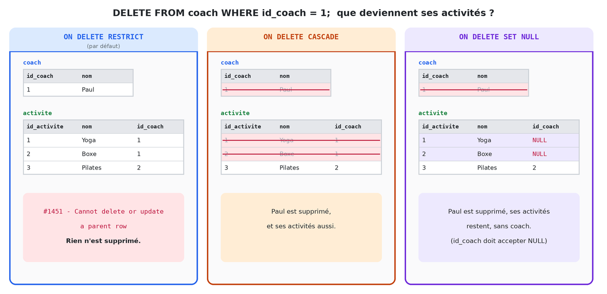

# Intégrité et transactions

## Mise en place des contraintes d'intégrité pour garantir la cohérence des données

Une base de données est **intègre** quand ses données sont **cohérentes** : chaque valeur est valide, chaque ligne est identifiable, et chaque lien entre deux tables pointe vers une ligne qui existe. Vous avez déjà mis en place la plupart de ces garanties en partie 5. Il reste une question importante : **que se passe-t-il quand on supprime ou qu'on modifie une ligne vers laquelle d'autres lignes pointent ?**

---

### 1. Les trois niveaux d'intégrité

| Intégrité | Ce qu'elle garantit | Comment | Vu en |
|---|---|---|---|
| **De domaine** | Chaque valeur est valide pour sa colonne | Types, `NOT NULL`, `CHECK`, `DEFAULT` | Partie 5.B |
| **D'entité** | Chaque ligne est unique et identifiable | `PRIMARY KEY`, `UNIQUE` | Parties 4.B et 5.B |
| **Référentielle** | Chaque clé étrangère pointe vers une ligne qui existe | `FOREIGN KEY`, et ses **actions référentielles** | Partie 5.A, et cette partie |

Sur l'intégrité référentielle, vous savez déjà que MySQL **refuse** de créer une ligne qui pointe vers une ligne inexistante (erreur `#1452`, partie 3). Mais l'inverse peut aussi casser la cohérence : si on supprime un coach, que deviennent les activités qu'il anime ? Elles pointeraient vers un coach qui n'existe plus. On parle alors de lignes **orphelines**.

Le SGBD ne laisse jamais apparaître de lignes orphelines. C'est à nous de lui dire **comment** les éviter, grâce aux **actions référentielles**.

---

### 2. Les actions référentielles

#### 2.1 La syntaxe

Les actions se déclarent avec la clé étrangère, avec `ON DELETE` (quand la ligne référencée est **supprimée**) et `ON UPDATE` (quand la clé primaire de la ligne référencée est **modifiée**) :

```sql
FOREIGN KEY (id_coach) REFERENCES coach(id_coach)
    ON DELETE action
    ON UPDATE action
```

Vocabulaire : la table `coach` est la table **parente** (celle qui est référencée), la table `activite` est la table **enfant** (celle qui contient la clé étrangère).

#### 2.2 Les actions possibles

{ style="display: block; margin: 0 auto" }

| Action | Quand on supprime (ou modifie) la ligne parente… |
|---|---|
| `RESTRICT` | … MySQL **refuse**, tant que des lignes enfants pointent vers elle |
| `NO ACTION` | Dans MySQL, identique à `RESTRICT` |
| `CASCADE` | … les lignes enfants sont **supprimées** (ou leur clé étrangère mise à jour) automatiquement |
| `SET NULL` | … la clé étrangère des lignes enfants est mise à **`NULL`** |
| `SET DEFAULT` | Prévue par le SQL standard, mais **refusée** par le moteur InnoDB de MySQL |

**Sans indication**, c'est `RESTRICT` qui s'applique, pour `ON DELETE` comme pour `ON UPDATE`. C'est ce que vous avez constaté en partie 5.A : impossible de supprimer un coach qui anime une activité.

#### 2.3 RESTRICT : refuser

```sql
DELETE FROM coach WHERE id_coach = 1;
```
```
#1451 - Cannot delete or update a parent row: a foreign key constraint fails
(`club_sport`.`activite`, CONSTRAINT `fk_activite_coach` FOREIGN KEY (`id_coach`)
REFERENCES `coach` (`id_coach`))
```

Pour supprimer ce coach, il faut d'abord réaffecter ses activités à un autre coach (`UPDATE activite SET id_coach = …`), ou les supprimer. C'est l'action **la plus sûre** : rien ne disparaît sans qu'on l'ait explicitement demandé.

#### 2.4 CASCADE : propager

```sql
FOREIGN KEY (id_adherent) REFERENCES adherent(id_adherent)
    ON DELETE CASCADE
```

Supprimer un adhérent supprime automatiquement toutes ses inscriptions. C'est le comportement que vous avez rencontré dans `scholar` en partie 3 : supprimer Bob Martin a supprimé ses notes et son inscription.

La cascade peut se **propager en chaîne** : si les inscriptions pointaient elles-mêmes vers d'autres tables en `CASCADE`, la suppression continuerait. Dans `scholar`, supprimer le département Chimie supprime ses 2 matières, qui suppriment à leur tour leurs 19 notes (partie 3). C'est puissant, et donc **dangereux**.

#### 2.5 SET NULL : détacher

```sql
CREATE TABLE activite (
    …
    id_coach INT UNSIGNED NULL,
    …
    FOREIGN KEY (id_coach) REFERENCES coach(id_coach)
        ON DELETE SET NULL
);
```

Si un coach quitte le club, ses activités **restent**, mais sans coach (`id_coach` vaut `NULL`), en attendant qu'on leur en attribue un autre.

`SET NULL` n'est possible que si la clé étrangère **accepte `NULL`**. Avec `id_coach INT NOT NULL`, MySQL refuse de créer la contrainte. C'est cohérent avec le MCD (partie 4.B) : `SET NULL` suppose que le lien est **facultatif**, donc une cardinalité **0,1** du côté de l'activité, et non 1,1.

#### 2.6 ON UPDATE

`ON UPDATE` s'applique quand la **clé primaire** d'une ligne parente change. Avec des clés artificielles en `AUTO_INCREMENT` (partie 4.B), cela n'arrive pratiquement jamais : on ne modifie pas un numéro. On écrit donc souvent `ON UPDATE CASCADE`, sans conséquence au quotidien, pour que la base reste cohérente si cela devait arriver.

`ON UPDATE` devient important avec des clés **naturelles**, qui peuvent changer : si le matricule d'un employé (partie 4) était corrigé, `ON UPDATE CASCADE` mettrait à jour tous les contrats qui y font référence.

---

### 3. Choisir la bonne action

Le choix ne se fait pas au hasard : il dépend de ce que **représente le lien**. Une bonne question à se poser : « si la ligne parente disparaît, la ligne enfant a-t-elle encore un sens ? »

| Situation | Exemple | Action conseillée |
|---|---|---|
| La ligne enfant **n'a aucun sens** sans la ligne parente | Les inscriptions d'un adhérent, les lignes d'une commande | `CASCADE` |
| La ligne enfant a **son existence propre**, le lien est **facultatif** | Une activité sans coach, en attendant un remplaçant | `SET NULL` |
| La ligne enfant a son existence propre, le lien est **obligatoire** | Un plat sans catégorie, une matière sans département | `RESTRICT` |
| La ligne enfant est un **historique** à conserver | Les commandes d'un client, les factures, les notes | `RESTRICT` (et on ne supprime pas la ligne parente : voir paragraphe 5) |

> **En cas de doute, `RESTRICT`.** Une suppression refusée se corrige en une requête. Une cascade non voulue efface des données qu'on ne récupère pas (sauf sauvegarde).

---

### 4. Application : revoir les choix de scholar

#### 4.1 La situation actuelle

Dans `scholar.sql`, **toutes** les clés étrangères sont en `ON DELETE CASCADE`. Reprenons-les une à une avec la grille du paragraphe 3 :

| Clé étrangère | Si la ligne parente disparaît… | Action actuelle | Action conseillée |
|---|---|---|---|
| `student_department.student_id` | Une inscription sans élève n'a pas de sens | `CASCADE` | `CASCADE` |
| `student_department.department_id` | On ne supprime pas un département qui a encore des élèves | `CASCADE` | `RESTRICT` |
| `note.student_id` | Les notes d'un élève supprimé n'ont plus de sens | `CASCADE` | `CASCADE` |
| `note.subject_id` | Supprimer une matière ne doit pas effacer les notes : ce sont des résultats officiels | `CASCADE` | `RESTRICT` |
| `subject.department_id` | Une matière ne doit pas disparaître avec son département sans qu'on le décide | `CASCADE` | `RESTRICT` |

Avec ces réglages, supprimer un élève supprime ses inscriptions et ses notes, comme aujourd'hui. Mais supprimer un département ou une matière qui sert encore est **refusé** : la cascade Chimie → matières → notes devient impossible.

> Pour `note.student_id`, `RESTRICT` est aussi un choix défendable : il oblige à supprimer explicitement les notes avant l'élève, et protège mieux l'historique scolaire. C'est une décision **de gestion**, à prendre avec les utilisateurs de la base, pas une question technique.

#### 4.2 Retrouver le nom des contraintes

Pour modifier une clé étrangère, il faut la **supprimer** puis la **recréer** avec les nouvelles actions. Et pour la supprimer, il faut connaître son nom. Les clés de `scholar.sql` n'ont pas été nommées : MySQL leur a donné un nom automatique, qu'on retrouve avec `SHOW CREATE TABLE` (partie 5.A) :

```sql
SHOW CREATE TABLE subject;
```
```
CREATE TABLE `subject` (
  …
  CONSTRAINT `subject_ibfk_1` FOREIGN KEY (`department_id`)
  REFERENCES `department` (`department_id`) ON DELETE CASCADE
) ENGINE=InnoDB …
```

Les noms automatiques suivent la forme `table_ibfk_n`, numérotés dans l'ordre de déclaration : `subject_ibfk_1`, `student_department_ibfk_1` et `_ibfk_2`, `note_ibfk_1` et `_ibfk_2`.

#### 4.3 Modifier les actions

```sql
USE scholar;

-- subject → department : RESTRICT
ALTER TABLE subject DROP FOREIGN KEY subject_ibfk_1;
ALTER TABLE subject
    ADD CONSTRAINT fk_subject_department
    FOREIGN KEY (department_id) REFERENCES department(department_id)
    ON DELETE RESTRICT ON UPDATE CASCADE;

-- student_department → department : RESTRICT
ALTER TABLE student_department DROP FOREIGN KEY student_department_ibfk_2;
ALTER TABLE student_department
    ADD CONSTRAINT fk_student_department_department
    FOREIGN KEY (department_id) REFERENCES department(department_id)
    ON DELETE RESTRICT ON UPDATE CASCADE;

-- note → subject : RESTRICT
ALTER TABLE note DROP FOREIGN KEY note_ibfk_2;
ALTER TABLE note
    ADD CONSTRAINT fk_note_subject
    FOREIGN KEY (subject_id) REFERENCES subject(subject_id)
    ON DELETE RESTRICT ON UPDATE CASCADE;
```

On en profite pour **nommer** les nouvelles contraintes (partie 5.B) : les messages d'erreur deviennent lisibles.

#### 4.4 Vérifier

```sql
DELETE FROM department WHERE department_id = 4;
```
```
#1451 - Cannot delete or update a parent row: a foreign key constraint fails
(`scholar`.`subject`, CONSTRAINT `fk_subject_department` …)
```

Le département Chimie a encore des matières et des élèves inscrits : la suppression est refusée, et rien n'a été effacé. (Deux contraintes bloquent ici la suppression : selon l'ordre dans lequel MySQL les vérifie, le message peut citer l'une ou l'autre.) De même, `DELETE FROM subject WHERE subject_id = 7;` est refusé tant que la matière a des notes.

En revanche, supprimer un élève fonctionne toujours, et supprime ses inscriptions et ses notes en cascade :

```sql
DELETE FROM student WHERE student_id = 2;
```

---

### 5. Ne pas supprimer : la suppression logique

Dans beaucoup d'applications, on ne supprime **jamais** vraiment certaines lignes : un client qui ferme son compte a quand même des commandes et des factures qu'il faut conserver. On utilise alors une **suppression logique** (en anglais, *soft delete*) : une colonne indique si la ligne est encore active.

```sql
ALTER TABLE adherent
ADD actif BOOLEAN NOT NULL DEFAULT TRUE;

-- « Supprimer » l'adhérent n°3 : il reste dans la base, mais désactivé
UPDATE adherent
SET actif = FALSE
WHERE id_adherent = 3;

-- Les requêtes de l'application ne montrent que les adhérents actifs
SELECT nom, prenom
FROM adherent
WHERE actif = TRUE;
```

Une variante très répandue : une colonne `supprime_le DATETIME NULL`, qui vaut `NULL` tant que la ligne est active, et contient la date de « suppression » ensuite. On sait ainsi **quand** la ligne a été désactivée.

Avantages : aucune donnée n'est perdue, l'historique reste complet, et une « suppression » se rattrape d'un simple `UPDATE`. Inconvénient : il ne faut jamais oublier le filtre `WHERE actif = TRUE` dans les requêtes.

> La suppression logique ne dispense pas de respecter la loi : le **RGPD** impose de pouvoir effacer réellement les données personnelles d'une personne qui le demande, ou qui ne sont plus nécessaires. Dans ce cas, on supprime ou on anonymise vraiment (en remplaçant le nom et l'email par des valeurs neutres, par exemple).

---

### 6. Désactiver temporairement les vérifications

Vous rencontrerez parfois cette instruction en tête des scripts d'import ou d'export :

```sql
SET FOREIGN_KEY_CHECKS = 0;
-- … import …
SET FOREIGN_KEY_CHECKS = 1;
```

Elle **désactive** la vérification des clés étrangères pour la session. Elle sert à importer des tables dans n'importe quel ordre (par exemple une sauvegarde complète), sans se soucier de l'ordre de création ou d'insertion (partie 5.A).

Mais pendant ce temps, **rien n'empêche** d'insérer des lignes orphelines, et MySQL ne vérifie pas les données déjà présentes quand on réactive le contrôle. À n'utiliser que pour importer des données qu'on sait déjà cohérentes, et à réactiver immédiatement.

---

### 7. Les règles que les contraintes ne peuvent pas exprimer

Certaines règles de gestion portent sur **plusieurs lignes** ou **plusieurs tables**, et ne peuvent pas s'écrire avec `CHECK` ou `FOREIGN KEY` (partie 5.B) :

- « une activité accueille au plus 15 inscrits » ;
- « un élève ne reçoit une note que dans une matière de l'un de ses départements » ;
- « le montant total d'une commande ne dépasse pas le plafond du client ».

Ces règles sont vérifiées :

- **par l'application**, avant d'écrire dans la base (c'est le cas le plus courant) ;
- ou **par la base**, grâce à des **déclencheurs** (en anglais, *triggers*) : de petits programmes SQL que MySQL exécute automatiquement avant ou après chaque `INSERT`, `UPDATE` ou `DELETE` sur une table. Leur écriture dépasse le cadre de ce cours, mais il est bon de savoir qu'ils existent.

**Pratiquons !!**

Rdv au fichier `7-exercices.md`, niveau 1.

---

### 8. En résumé

- L'intégrité d'une base repose sur trois niveaux : **de domaine** (valeurs valides), **d'entité** (lignes identifiables) et **référentielle** (liens valides).
- Les **actions référentielles** décident de ce qui arrive aux lignes enfants quand une ligne parente est supprimée (`ON DELETE`) ou que sa clé change (`ON UPDATE`).
- `RESTRICT` (par défaut) **refuse**, `CASCADE` **propage**, `SET NULL` **détache** (si la clé étrangère accepte `NULL`).
- Le choix dépend du sens du lien : `CASCADE` si la ligne enfant n'a pas de sens seule, `RESTRICT` pour protéger, `SET NULL` pour un lien facultatif. **En cas de doute, `RESTRICT`.**
- Pour modifier une action, on **supprime** la clé étrangère (`DROP FOREIGN KEY`) puis on la **recrée**.
- La **suppression logique** (`actif`, `supprime_le`) conserve l'historique sans casser l'intégrité.

---

*Sources :*
*- Julien POIRIER*
*- sql.sh*
*- dev.mysql.com*

---

© Vincent Chiofalo
