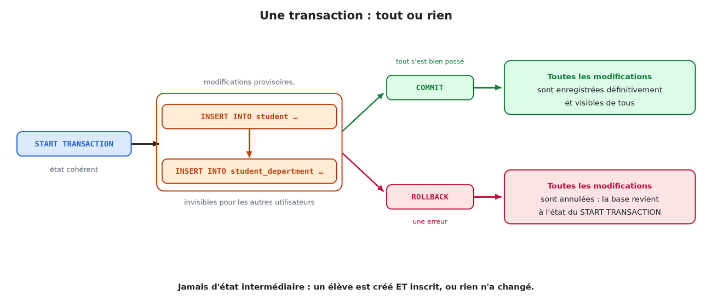

# Intégrité et transactions

## Utilisation des transactions pour assurer la fiabilité des opérations

Les contraintes de la partie 7.A protègent **chaque requête** : une requête qui casserait la cohérence de la base est refusée. Mais beaucoup d'opérations demandent **plusieurs** requêtes, qui n'ont de sens qu'**ensemble**. Si une panne ou une erreur survient au milieu, la base peut se retrouver dans un état incohérent, alors que chaque requête prise isolément était valide. Les **transactions** règlent ce problème.

---

### 1. Le problème

#### 1.1 L'exemple classique : le virement

Un virement de 100 € du compte A vers le compte B demande deux requêtes :

```sql
UPDATE compte SET solde = solde - 100 WHERE id_compte = 'A';
UPDATE compte SET solde = solde + 100 WHERE id_compte = 'B';
```

Si le serveur s'arrête **entre les deux** (panne de courant, plantage de l'application, erreur dans la seconde requête), les 100 € ont quitté le compte A… et ne sont jamais arrivés sur le compte B. Chaque requête était correcte, mais l'ensemble ne l'est pas.

#### 1.2 Dans scholar

Le secrétariat ajoute un nouvel élève et l'inscrit en Biologie. Deux requêtes, là aussi :

```sql
INSERT INTO student (first_name, last_name, birth_date, email, city)
VALUES ('Lina', 'Garnier', '2005-04-18', 'lina.garnier@mail.com', 'Lyon');

INSERT INTO student_department (student_id, department_id, enrollment_date)
VALUES (LAST_INSERT_ID(), 33, CURDATE());
```

Une faute de frappe sur le numéro du département (33 au lieu de 3) fait échouer la seconde requête (erreur `#1452`, partie 3). Mais la première a déjà été exécutée : Lina Garnier existe dans la base, **sans inscription**. Il faut s'en apercevoir, et corriger à la main.

`LAST_INSERT_ID()` (partie 3) renvoie le numéro `AUTO_INCREMENT` qui vient d'être attribué à Lina : c'est ce qui permet d'enchaîner les deux insertions sans connaître ce numéro à l'avance.

---

### 2. La transaction

#### 2.1 Définition

Une **transaction** est un ensemble de requêtes que le SGBD traite comme **une seule opération** : soit **toutes** sont appliquées, soit **aucune**.

{ style="display: block; margin: 0 auto" }

#### 2.2 Les propriétés ACID

Les transactions des bases relationnelles garantissent quatre propriétés, résumées par l'acronyme **ACID** :

| Propriété | Signification | Pour le virement |
|---|---|---|
| **A**tomicité | Tout ou rien : toutes les requêtes sont appliquées, ou aucune | Jamais de débit sans crédit |
| **C**ohérence | La base passe d'un état valide à un autre état valide : toutes les contraintes sont respectées | Le total des deux comptes ne change pas |
| **I**solation | Les transactions simultanées ne se perturbent pas : les modifications en cours sont invisibles des autres | Personne ne voit l'argent « en route », ni débité ni crédité |
| **D**urabilité | Une fois validée, une transaction est conservée, même en cas de panne | Le virement confirmé n'est jamais perdu |

Ces garanties sont l'un des grands atouts des bases relationnelles (partie 9). Dans MySQL, c'est le moteur de stockage **InnoDB** qui les assure : c'est le moteur par défaut, celui de toutes les tables de ce cours. L'ancien moteur MyISAM, qu'on rencontre encore dans de vieilles bases, ne gère **pas** les transactions.

---

### 3. Les transactions dans MySQL

#### 3.1 Le mode autocommit

Par défaut, MySQL fonctionne en mode **autocommit** : chaque requête est une transaction à elle seule, validée **automatiquement** dès qu'elle a réussi. C'est pour cela que les modifications de la partie 3 étaient immédiates et définitives.

Pour regrouper plusieurs requêtes, il faut donc **ouvrir** une transaction explicitement.

#### 3.2 START TRANSACTION, COMMIT, ROLLBACK

| Instruction | Rôle |
|---|---|
| `START TRANSACTION` (ou `BEGIN`) | Ouvre une transaction : les requêtes suivantes ne sont plus validées automatiquement |
| `COMMIT` | **Valide** la transaction : toutes ses modifications deviennent définitives et visibles de tous |
| `ROLLBACK` | **Annule** la transaction : toutes ses modifications sont effacées, la base revient à son état du `START TRANSACTION` |

Après un `COMMIT` ou un `ROLLBACK`, la transaction est terminée, et MySQL revient au mode autocommit.

#### 3.3 Exemple

```sql
START TRANSACTION;

INSERT INTO student (first_name, last_name, birth_date, email, city)
VALUES ('Lina', 'Garnier', '2005-04-18', 'lina.garnier@mail.com', 'Lyon');

INSERT INTO student_department (student_id, department_id, enrollment_date)
VALUES (LAST_INSERT_ID(), 33, CURDATE());
-- #1452 - Cannot add or update a child row: a foreign key constraint fails …

ROLLBACK;
```

La seconde requête échoue : on annule. Lina Garnier n'a **pas** été créée, la base est exactement dans son état de départ. On corrige le numéro du département, et on recommence :

```sql
START TRANSACTION;

INSERT INTO student (first_name, last_name, birth_date, email, city)
VALUES ('Lina', 'Garnier', '2005-04-18', 'lina.garnier@mail.com', 'Lyon');

INSERT INTO student_department (student_id, department_id, enrollment_date)
VALUES (LAST_INSERT_ID(), 3, CURDATE());

COMMIT;
```

Cette fois, les deux requêtes ont réussi : on valide. Lina Garnier existe, **et** elle est inscrite en Biologie.

> **Une erreur n'annule pas la transaction toute seule.** Quand une requête échoue dans une transaction, seule **cette** requête est refusée : les précédentes restent en attente. C'est à **vous** (ou à l'application) de décider : `ROLLBACK` pour tout annuler, ou corriger la requête fautive puis `COMMIT`.

> **Un numéro peut être « perdu ».** Après le `ROLLBACK`, l'`AUTO_INCREMENT` ne revient pas en arrière : le numéro attribué à la première Lina reste inutilisé, et la seconde reçoit le suivant. C'est normal (partie 3) : les numéros doivent être uniques, pas forcément consécutifs.

#### 3.4 Ce qu'une transaction ne peut pas annuler

Les instructions du **LDD** (`CREATE`, `ALTER`, `DROP`, `TRUNCATE`, partie 5) provoquent une **validation automatique** (*commit implicite*) : elles valident la transaction en cours, puis s'exécutent immédiatement, sans retour possible.

```sql
START TRANSACTION;
DELETE FROM note WHERE note_id = 1;
ALTER TABLE note ADD commentaire VARCHAR(255);   -- valide aussi le DELETE !
ROLLBACK;                                        -- trop tard : rien n'est annulé
```

Les transactions protègent les **données** (`INSERT`, `UPDATE`, `DELETE`), pas la **structure** des tables. Avant de modifier une structure, on fait une **sauvegarde** (partie 1.B).

#### 3.5 Les points de sauvegarde : SAVEPOINT

Dans une longue transaction, on peut poser des **points de sauvegarde** et revenir à l'un d'eux, sans tout annuler :

```sql
START TRANSACTION;
INSERT INTO department (department_name) VALUES ('Économie');
SAVEPOINT apres_departement;
INSERT INTO subject (subject_name, department_id) VALUES ('Microéconomie', LAST_INSERT_ID());
ROLLBACK TO SAVEPOINT apres_departement;   -- annule seulement la matière
COMMIT;                                     -- valide le département
```

L'usage est plus rare, mais le principe est utile dans les traitements longs, comme un import.

---

### 4. Tester les transactions : la console MySQL

#### 4.1 La limite de phpMyAdmin

phpMyAdmin est une application web : à chaque clic sur **Exécuter**, il ouvre une **nouvelle connexion** à MySQL, exécute les requêtes, puis ferme la connexion. Une transaction ouverte et non validée à la fin d'une exécution est **perdue** (annulée).

Dans phpMyAdmin, une transaction doit donc être écrite **en entier dans une seule exécution**, du `START TRANSACTION` jusqu'au `COMMIT` ou au `ROLLBACK`. On ne peut pas ouvrir une transaction, regarder le résultat, puis décider au clic suivant.

#### 4.2 La console MySQL

Pour expérimenter pas à pas, on utilise la **console MySQL** (partie 1.B), qui garde la même connexion tant qu'on ne la ferme pas :

1. Clic gauche sur l'icône de WampServer, menu **MySQL**, puis **Console MySQL**.
2. Utilisateur `root`, mot de passe vide (appuyer sur **Entrée**).
3. Sélectionner la base : `USE scholar;`

Chaque requête se termine par un `;` et s'exécute avec **Entrée**. Le résultat s'affiche sous forme de tableau en texte.

```
mysql> START TRANSACTION;
Query OK, 0 rows affected (0.00 sec)

mysql> DELETE FROM note WHERE student_id = 1;
Query OK, 3 rows affected (0.00 sec)

mysql> SELECT COUNT(*) FROM note WHERE student_id = 1;
+----------+
| COUNT(*) |
+----------+
|        0 |
+----------+

mysql> ROLLBACK;
Query OK, 0 rows affected (0.01 sec)

mysql> SELECT COUNT(*) FROM note WHERE student_id = 1;
+----------+
| COUNT(*) |
+----------+
|        3 |
+----------+
```

Les 3 notes d'Alice Dupont, supprimées dans la transaction, sont revenues après le `ROLLBACK`.

> **Une astuce de prudence** : avant un `UPDATE` ou un `DELETE` important, ouvrez une transaction. Vérifiez le résultat avec un `SELECT`, puis validez (`COMMIT`) ou annulez (`ROLLBACK`). C'est le filet de sécurité qui manquait en partie 3.

---

### 5. Transactions et accès simultanés

Une base de données est utilisée par **plusieurs personnes en même temps** : plusieurs secrétaires, des centaines de visiteurs d'un site… C'est le **I** d'ACID, l'**isolation**, qui évite qu'elles se perturbent.

#### 5.1 L'isolation en pratique

Ouvrez **deux consoles MySQL** côte à côte : elles représentent deux utilisateurs, A et B.

| Étape | Console A | Console B |
|---|---|---|
| 1 | `START TRANSACTION;` | |
| 2 | `UPDATE student SET city = 'Nice' WHERE student_id = 1;` | |
| 3 | `SELECT city FROM student WHERE student_id = 1;` → **Nice** | `SELECT city FROM student WHERE student_id = 1;` → **Paris** |
| 4 | | `UPDATE student SET city = 'Lille' WHERE student_id = 1;` → **attend…** |
| 5 | `COMMIT;` | La requête en attente s'exécute enfin |
| 6 | `SELECT city …` → **Lille** | `SELECT city …` → **Lille** |

Ce qu'on observe :

- **Étape 3** : A voit sa modification, B ne la voit pas. Tant qu'elle n'est pas validée, une modification reste **invisible** des autres.
- **Étape 4** : B veut modifier la **même ligne**. MySQL la fait **attendre** : A a posé un **verrou** sur cette ligne, jusqu'à la fin de sa transaction.
- **Étape 5** : A valide, le verrou est libéré, et la modification de B s'applique à son tour.

Si A ne termine jamais sa transaction, B finit par abandonner au bout de 50 secondes :

```
ERROR 1205 (HY000): Lock wait timeout exceeded; try restarting transaction
```

C'est pourquoi une transaction doit toujours être **courte** : on ne laisse jamais une transaction ouverte pendant qu'on va prendre un café.

#### 5.2 Les niveaux d'isolation

Une isolation parfaite ralentirait beaucoup les accès simultanés. Le SQL définit donc quatre **niveaux d'isolation**, du plus permissif au plus strict :

| Niveau | Ce qu'une transaction peut voir des autres |
|---|---|
| `READ UNCOMMITTED` | Même les modifications **non validées** (« lectures sales ») |
| `READ COMMITTED` | Seulement les modifications validées, même si elles l'ont été pendant la transaction |
| `REPEATABLE READ` | Les données telles qu'elles étaient au **début** de la transaction : relire la même ligne donne toujours le même résultat |
| `SERIALIZABLE` | Comme si les transactions s'exécutaient les unes **après** les autres |

`REPEATABLE READ` est le niveau **par défaut** de MySQL. Il convient à la grande majorité des usages : on ne le change que dans des cas très particuliers.

#### 5.3 Réserver une ligne : SELECT … FOR UPDATE

Le club de sport limite chaque activité à 15 inscrits. Pour inscrire un adhérent, l'application **compte** d'abord les inscrits, puis **insère** si le compte est inférieur à 15. Mais si deux adhérents s'inscrivent **exactement en même temps** à une activité qui compte 14 inscrits, les deux comptages renvoient 14, et les deux inscriptions passent : l'activité se retrouve à 16.

`SELECT … FOR UPDATE` lit des lignes **en les verrouillant**, comme si on allait les modifier. La seconde transaction doit attendre que la première soit terminée :

```sql
START TRANSACTION;

-- Verrouille l'activité : une autre inscription simultanée attendra ici
SELECT id_activite FROM activite WHERE id_activite = 1 FOR UPDATE;

SELECT COUNT(*) FROM inscription WHERE id_activite = 1;
-- Si le résultat est inférieur à 15 :
INSERT INTO inscription (id_adherent, id_activite) VALUES (7, 1);

COMMIT;
```

C'est l'application (en PHP, en Node…) qui fait le test « inférieur à 15 » entre les deux requêtes, à l'intérieur de la transaction.

#### 5.4 L'interblocage

Si la transaction A verrouille une ligne 1 puis demande la ligne 2, pendant que la transaction B a verrouillé la ligne 2 et demande la ligne 1, chacune attend l'autre indéfiniment : c'est un **interblocage** (*deadlock*). MySQL le détecte, et annule l'une des deux transactions :

```
ERROR 1213 (40001): Deadlock found when trying to get lock; try restarting transaction
```

L'application doit alors simplement **recommencer** la transaction annulée. Pour limiter le risque : des transactions courtes, qui accèdent aux tables toujours dans le même ordre.

---

### 6. Les transactions dans une application

En pratique, les transactions sont surtout utilisées dans le **code** de l'application. Voici l'inscription de Lina Garnier en PHP, avec PDO :

```php
<?php
$pdo = new PDO('mysql:host=localhost;dbname=scholar;charset=utf8mb4', 'root', '');
$pdo->setAttribute(PDO::ATTR_ERRMODE, PDO::ERRMODE_EXCEPTION);

try {
    $pdo->beginTransaction();

    $stmt = $pdo->prepare('INSERT INTO student (first_name, last_name, birth_date, email, city)
                           VALUES (?, ?, ?, ?, ?)');
    $stmt->execute(['Lina', 'Garnier', '2005-04-18', 'lina.garnier@mail.com', 'Lyon']);
    $studentId = $pdo->lastInsertId();

    $stmt = $pdo->prepare('INSERT INTO student_department (student_id, department_id, enrollment_date)
                           VALUES (?, ?, CURDATE())');
    $stmt->execute([$studentId, 3]);

    $pdo->commit();
    echo 'Élève créé et inscrit.';
} catch (PDOException $e) {
    $pdo->rollBack();
    echo 'Erreur, rien n\'a été enregistré : ' . $e->getMessage();
}
```

Le principe est toujours le même, quel que soit le langage :

1. **ouvrir** la transaction ;
2. exécuter les requêtes ;
3. **valider** si tout s'est bien passé ;
4. **annuler** dès qu'une erreur survient (le bloc `catch`).

---

### 7. Application : un import sûr

L'intégration de données de la partie 6 se termine par plusieurs `INSERT INTO … SELECT` dans des tables différentes. On les regroupe dans une transaction :

```sql
START TRANSACTION;

INSERT INTO student (first_name, last_name, birth_date, email, phone_number, city)
SELECT DISTINCT prenom, nom, STR_TO_DATE(date_naissance, '%d/%m/%Y'), email, telephone, ville
FROM import_eleve;

INSERT INTO student_department (student_id, department_id, enrollment_date)
SELECT DISTINCT s.student_id, d.department_id, CURDATE()
FROM import_eleve i
INNER JOIN student s
    ON s.first_name = i.prenom
   AND s.last_name = i.nom
   AND s.birth_date = STR_TO_DATE(i.date_naissance, '%d/%m/%Y')
INNER JOIN department d ON d.department_name = i.departement;

-- Vérifications : nombre d'élèves, nombre d'inscriptions…
SELECT COUNT(*) FROM student;
SELECT COUNT(*) FROM student_department;

COMMIT;   -- ou ROLLBACK si les vérifications révèlent un problème
```

Si l'une des insertions échoue, ou si les vérifications ne donnent pas les nombres attendus, un `ROLLBACK` remet la base dans son état d'avant l'import. Il suffit de corriger la table de transit et de recommencer. Pour pouvoir décider entre `COMMIT` et `ROLLBACK` après les vérifications, cet enchaînement s'exécute dans la **console MySQL**.

**Pratiquons !!**

Rdv au fichier `7-exercices.md`, niveaux 2 et 3.

---

### 8. En résumé

- Une **transaction** regroupe plusieurs requêtes en une seule opération : **tout ou rien**.
- Elle garantit les propriétés **ACID** : Atomicité, Cohérence, Isolation, Durabilité (moteur InnoDB).
- Par défaut, MySQL est en **autocommit** : chaque requête est validée immédiatement.
- `START TRANSACTION` ouvre une transaction, `COMMIT` la valide, `ROLLBACK` l'annule.
- Une erreur n'annule pas la transaction d'elle-même : c'est à nous de faire le `ROLLBACK`.
- `CREATE`, `ALTER`, `DROP` et `TRUNCATE` valident automatiquement la transaction en cours : ils ne s'annulent pas.
- Les modifications non validées sont **invisibles** des autres utilisateurs, et les lignes modifiées sont **verrouillées** jusqu'à la fin de la transaction. D'où la règle : des transactions **courtes**.
- Dans phpMyAdmin, une transaction s'écrit en une seule exécution ; pour travailler pas à pas, on utilise la **console MySQL**.

---

*Sources :*
*- Julien POIRIER*
*- sql.sh*
*- dev.mysql.com*

---

© Vincent Chiofalo
