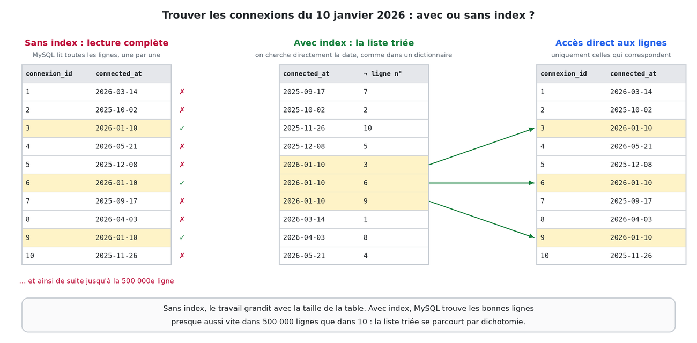

# Optimiser les requêtes SQL

## Indexation et analyse des requêtes

Sur une petite base comme `scholar`, toutes les requêtes sont instantanées. Mais une vraie application peut stocker des **millions** de lignes : commandes, connexions, messages, mesures… Une requête mal écrite ou une table mal indexée peut alors prendre plusieurs secondes, et ralentir tout le site. Cette partie explique **comment MySQL trouve les lignes**, et comment l'aider avec les **index**.

---

### 1. Des données de test

Pour observer des différences de vitesse, il faut beaucoup de données. Le script `donnees/scholar_connexions.sql` ajoute à `scholar` une table `connexion` : **500 000 connexions** à l'espace numérique de l'école, générées aléatoirement sur une année scolaire (du 1er septembre 2025 au 31 août 2026).

```
connexion (connexion_id, #student_id, connected_at, page, duration_s)
```

| Colonne | Contenu |
|---|---|
| `connexion_id` | Numéro de la connexion |
| `student_id` | L'élève qui s'est connecté |
| `connected_at` | Date et heure de la connexion |
| `page` | La page consultée : `accueil`, `notes`, `planning`, `messagerie` ou `profil` |
| `duration_s` | La durée de la visite, en secondes |

Exécutez ce script dans l'onglet **SQL** de phpMyAdmin, sur une base `scholar` fraîchement importée. Il utilise une requête **récursive** (`WITH RECURSIVE`) pour générer les lignes : vous n'avez pas besoin de la comprendre en détail. L'exécution peut prendre jusqu'à une minute.

> **Les durées indiquées dans ce support sont des ordres de grandeur.** Elles dépendent de l'ordinateur, et une même requête est souvent plus rapide la deuxième fois : MySQL garde en mémoire les données qu'il vient de lire. Exécutez chaque requête plusieurs fois, et comparez les durées affichées par phpMyAdmin (« traitement en … seconde(s) »).

---

### 2. Comment MySQL trouve les lignes

#### 2.1 La lecture complète de la table

Cherchons les connexions du 10 janvier 2026 :

```sql
SELECT *
FROM connexion
WHERE connected_at BETWEEN '2026-01-10 00:00:00' AND '2026-01-10 23:59:59';
```

Résultat : environ 1 400 lignes (le nombre exact varie, puisque les données sont aléatoires). Pour les trouver, MySQL n'a pas le choix : il **lit les 500 000 lignes**, une par une, et garde celles qui respectent la condition. C'est une **lecture complète de la table** (en anglais, *full table scan*).

C'est comme chercher un mot dans un livre **sans index** : il faut lire toutes les pages. Le temps de recherche augmente avec la taille de la table : deux fois plus de lignes, deux fois plus de temps.

#### 2.2 L'index

Un **index** est une structure à part, que MySQL maintient à côté de la table. Il contient les valeurs d'une ou plusieurs colonnes, **triées**, et pour chacune, l'emplacement des lignes correspondantes.

{ style="display: block; margin: 0 auto" }

C'est exactement l'index à la fin d'un livre, ou un dictionnaire : comme les mots sont triés, on trouve « jointure » en quelques secondes, en ouvrant le livre au milieu, puis dans la bonne moitié, et ainsi de suite (une recherche **par dichotomie**). Sur 500 000 valeurs triées, une vingtaine d'étapes suffisent.

Dans MySQL (moteur InnoDB), les index sont des **arbres B** (*B-tree*), une structure arborescente qui permet ces recherches rapides et qui reste triée quand on ajoute ou supprime des lignes.

#### 2.3 Créer un index

```sql
CREATE INDEX idx_connexion_connected_at
ON connexion (connected_at);
```

La création prend quelques secondes : MySQL lit toute la table et trie les 500 000 dates. Exécutez à nouveau la recherche du 10 janvier : elle devient **beaucoup** plus rapide, car MySQL va directement aux bonnes lignes au lieu de lire toute la table.

Un index se nomme comme une contrainte (partie 5.B) : le préfixe `idx_`, puis la table et la ou les colonnes.

Autres instructions utiles :

```sql
-- Lister les index d'une table
SHOW INDEX FROM connexion;

-- Supprimer un index
DROP INDEX idx_connexion_connected_at ON connexion;

-- Créer un index sur une table existante (autre écriture)
ALTER TABLE connexion ADD INDEX idx_connexion_connected_at (connected_at);
```

Dans phpMyAdmin, les index d'une table apparaissent dans l'onglet **Structure**, sous la liste des colonnes.

#### 2.4 Les index créés automatiquement

Vous avez déjà des index sans le savoir. MySQL en crée automatiquement :

- sur la **clé primaire** : c'est même elle qui détermine l'ordre de rangement des lignes dans une table InnoDB ;
- sur chaque colonne **`UNIQUE`** : pour vérifier l'unicité à chaque insertion, MySQL doit retrouver rapidement si une valeur existe déjà. C'est pourquoi une contrainte `UNIQUE` se supprime avec `DROP INDEX` (partie 5.B) ;
- sur chaque **clé étrangère**, si elle n'est pas déjà indexée : pour vérifier une clé étrangère ou appliquer une action `ON DELETE` (partie 7.A), MySQL doit retrouver rapidement les lignes enfants.

`SHOW INDEX FROM connexion;` montre ainsi trois index : `PRIMARY` (sur `connexion_id`), celui de la clé étrangère `student_id`, et `idx_connexion_connected_at` que nous venons de créer.

---

### 3. Analyser une requête : EXPLAIN

#### 3.1 Le plan d'exécution

Avant d'exécuter une requête, MySQL choisit **comment** il va la traiter : quelle table lire en premier, quel index utiliser, dans quel ordre faire les jointures… C'est le **plan d'exécution**. `EXPLAIN`, placé devant une requête, affiche ce plan **sans exécuter** la requête :

```sql
EXPLAIN
SELECT *
FROM connexion
WHERE connected_at BETWEEN '2026-01-10 00:00:00' AND '2026-01-10 23:59:59';
```

Sans l'index :

| id | select_type | table | type | possible_keys | key | rows | Extra |
|---|---|---|---|---|---|---|---|
| 1 | SIMPLE | connexion | **ALL** | *NULL* | *NULL* | **~ 500 000** | Using where |

Avec l'index :

| id | select_type | table | type | possible_keys | key | rows | Extra |
|---|---|---|---|---|---|---|---|
| 1 | SIMPLE | connexion | **range** | idx_connexion_connected_at | **idx_connexion_connected_at** | **~ 1 400** | Using index condition |

(Le résultat contient d'autres colonnes, moins utiles ici. Les valeurs de `rows` sont des **estimations**, qui varient d'une exécution à l'autre.)

Dans phpMyAdmin, le lien **Expliquer SQL**, affiché sous chaque requête exécutée, produit le même résultat.

#### 3.2 Lire le résultat

Trois colonnes suffisent pour l'essentiel :

| Colonne | Signification |
|---|---|
| `type` | **Comment** MySQL accède à la table (voir ci-dessous) |
| `key` | L'index **réellement utilisé** (`NULL` : aucun) |
| `rows` | Le nombre de lignes que MySQL **estime** devoir examiner |

Les principales valeurs de `type`, de la plus rapide à la plus lente :

| `type` | Signification | Exemple |
|---|---|---|
| `const` | Une seule ligne, trouvée par la clé primaire ou un index unique | `WHERE connexion_id = 42` |
| `eq_ref` | Dans une jointure, une seule ligne par ligne de l'autre table, par clé primaire ou unique | Jointure `connexion` → `student` sur `student_id` |
| `ref` | Plusieurs lignes, trouvées par un index sur une valeur précise | `WHERE student_id = 7` |
| `range` | Un intervalle de valeurs d'un index | `BETWEEN`, `<`, `>`, `IN (…)`, `LIKE 'abc%'` |
| `index` | Lecture de **tout** l'index (mieux que la table, mais tout de même complète) | |
| `ALL` | Lecture **complète de la table** | Aucun index utilisable |

> **À surveiller** : un `type` à `ALL` avec un `rows` élevé, sur une requête fréquente. C'est le signe qu'un index manque, ou qu'il existe mais que la requête l'empêche de servir (partie 8.B).

Dans la colonne `Extra`, deux mentions méritent l'attention :

- **`Using filesort`** : MySQL doit **trier** lui-même les résultats (pour un `ORDER BY`), ce qui coûte cher sur beaucoup de lignes. Un index sur la colonne de tri peut l'éviter ;
- **`Using temporary`** : MySQL crée une table temporaire, souvent pour un `GROUP BY` ou un `DISTINCT`.

#### 3.3 Mesurer réellement : EXPLAIN ANALYZE

`EXPLAIN` montre ce que MySQL **prévoit** de faire. `EXPLAIN ANALYZE` (MySQL 8.0.18 et plus) **exécute** la requête et affiche le plan avec les **durées réelles** et le nombre réel de lignes à chaque étape :

```sql
EXPLAIN ANALYZE
SELECT *
FROM connexion
WHERE connected_at BETWEEN '2026-01-10 00:00:00' AND '2026-01-10 23:59:59';
```

```
-> Index range scan on connexion using idx_connexion_connected_at
   over ('2026-01-10 00:00:00' <= connected_at <= '2026-01-10 23:59:59'),
   with index condition: (…)
   (cost=… rows=1387) (actual time=0.05..4.2 rows=1387 loops=1)
```

`actual time` donne le temps réel en millisecondes, `rows` le nombre réel de lignes. Le résultat se lit plus facilement dans la console MySQL (partie 7.B) que dans phpMyAdmin.

---

### 4. Les index sur plusieurs colonnes

#### 4.1 L'index composite

Un index peut porter sur **plusieurs colonnes** : c'est un index **composite**.

```sql
CREATE INDEX idx_connexion_student_date
ON connexion (student_id, connected_at);
```

Les valeurs sont triées d'abord par `student_id`, puis, pour un même élève, par `connected_at`. C'est le principe de l'**annuaire téléphonique**, trié par nom, puis par prénom.

Cet index accélère une requête comme :

```sql
-- Les connexions de l'élève n°7 en janvier 2026
SELECT *
FROM connexion
WHERE student_id = 7
  AND connected_at BETWEEN '2026-01-01' AND '2026-01-31 23:59:59';
```

#### 4.2 La règle du préfixe gauche

Un index composite n'est utilisable que si la requête filtre sur ses colonnes **en partant de la gauche** :

| Condition | `idx_connexion_student_date (student_id, connected_at)` utilisable ? |
|---|---|
| `WHERE student_id = 7` | Oui (première colonne) |
| `WHERE student_id = 7 AND connected_at > '2026-01-01'` | Oui (les deux colonnes) |
| `WHERE connected_at > '2026-01-01'` | **Non** : la première colonne n'est pas filtrée |

Dans un annuaire trié par nom puis prénom, on trouve vite « Dupont Alice » ou tous les « Dupont », mais pas toutes les « Alice » : elles sont dispersées dans tout l'annuaire.

L'**ordre des colonnes** d'un index composite est donc un vrai choix : on place en premier la colonne qui sert le plus souvent seule dans les filtres, ou celle qui est comparée avec `=`.

> Avec cet index composite, l'index créé automatiquement pour la clé étrangère `student_id` devient **redondant** : `idx_connexion_student_date` commence par `student_id`, il peut le remplacer.

---

### 5. Le coût des index

Si les index accélèrent les recherches, pourquoi ne pas en mettre sur toutes les colonnes ? Parce qu'ils ont un **coût** :

- **de la place** : chaque index est une copie triée des colonnes concernées, stockée sur le disque et en mémoire ;
- **des écritures plus lentes** : à chaque `INSERT`, `UPDATE` ou `DELETE`, MySQL doit mettre à jour **tous** les index de la table, en plus de la table elle-même.

Il faut donc indexer **ce qui sert**, et rien de plus.

#### 5.1 Quelles colonnes indexer ?

| À indexer | Pourquoi |
|---|---|
| Les colonnes souvent utilisées dans les `WHERE` | C'est le premier usage des index |
| Les colonnes de jointure | Les clés étrangères le sont déjà automatiquement |
| Les colonnes souvent utilisées dans un `ORDER BY` | Évite le tri (`Using filesort`) |
| Les colonnes **sélectives** | Une condition qui ne garde qu'une petite partie des lignes |

#### 5.2 Ce qu'il est inutile d'indexer

- **Les petites tables** : sur quelques centaines de lignes, une lecture complète est déjà instantanée. Inutile d'indexer `department` ou `subject`.
- **Les colonnes peu sélectives** : la colonne `page` n'a que 5 valeurs différentes. `WHERE page = 'notes'` garde environ 100 000 lignes sur 500 000 : MySQL juge souvent plus rapide de lire toute la table que de passer par un index pour en récupérer un cinquième. Même chose pour un booléen (`actif`), qui n'a que deux valeurs.
- **Les colonnes rarement utilisées pour chercher** : la colonne `duration_s`, par exemple, si on ne filtre jamais dessus.

> **La méthode** : ne pas indexer « au cas où », mais **mesurer**. On repère les requêtes lentes et fréquentes, on les analyse avec `EXPLAIN`, on ajoute l'index qui manque, puis on vérifie avec `EXPLAIN` qu'il est bien utilisé.

**Pratiquons !!**

Rdv au fichier `8-exercices.md`, niveau 1.

---

### 6. En résumé

- Sans index, MySQL fait une **lecture complète de la table** : le temps de recherche augmente avec le nombre de lignes.
- Un **index** est une copie triée d'une ou plusieurs colonnes, qui permet de trouver les lignes très rapidement : `CREATE INDEX nom ON table (colonnes);`.
- MySQL crée automatiquement un index sur la **clé primaire**, les colonnes **`UNIQUE`** et les **clés étrangères**.
- `EXPLAIN` affiche le **plan d'exécution** : `type` (de `const`, le meilleur, à `ALL`, la lecture complète), `key` (l'index utilisé) et `rows` (le nombre estimé de lignes examinées). `EXPLAIN ANALYZE` mesure les durées réelles.
- Un **index composite** ne sert que si la requête filtre sur ses colonnes **en partant de la gauche**.
- Les index ont un **coût** (place, écritures plus lentes) : on indexe les colonnes utiles et sélectives des grosses tables, après avoir mesuré.

---

*Sources :*
*- Julien POIRIER*
*- sql.sh*
*- dev.mysql.com*

---

© Vincent Chiofalo
